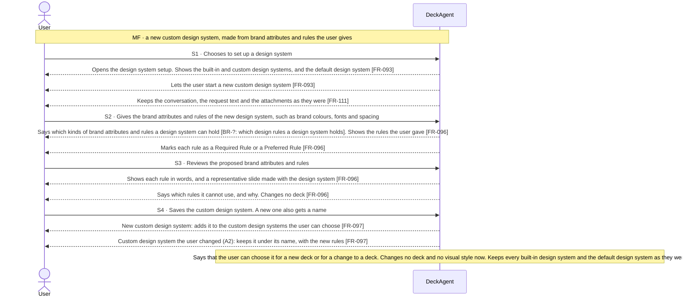
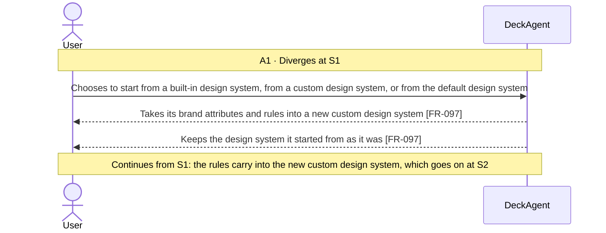
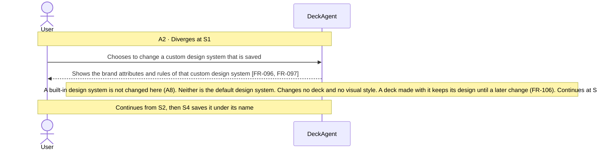
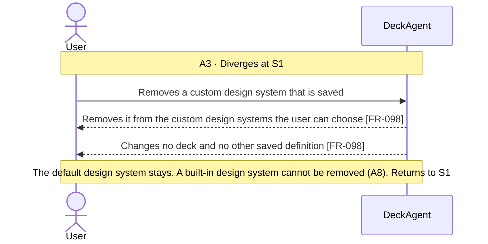
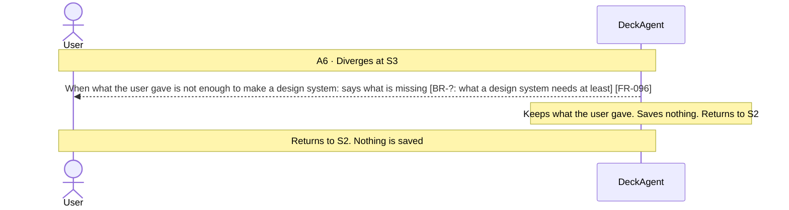
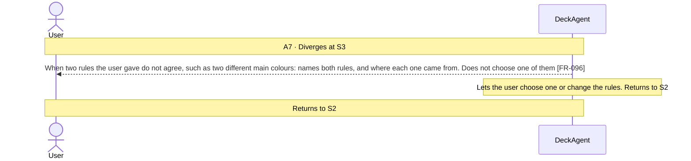
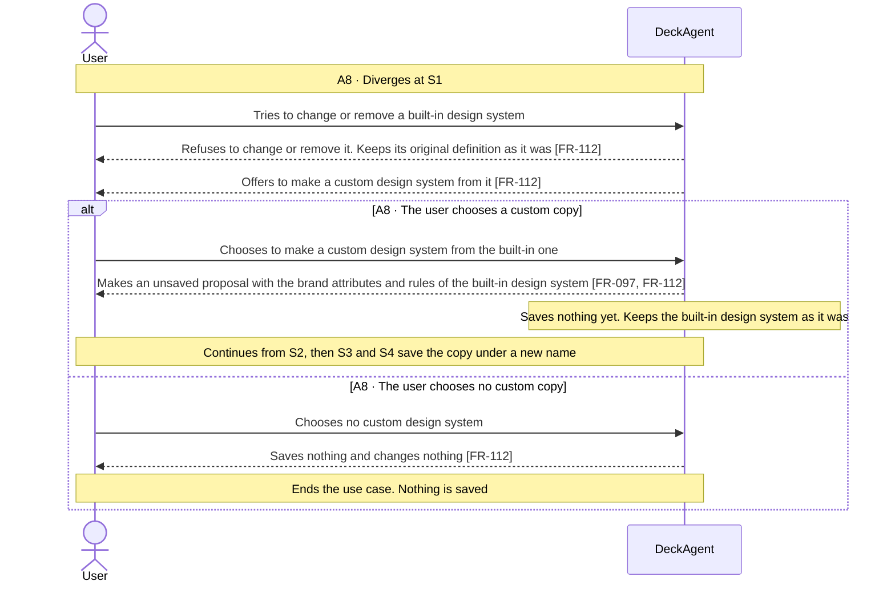

Updated at: 26-10-2026

<!-- A use case models the ideal product (UCG-01 in 03-use-cases/_CRITERIA.md). Every flow it holds is a
     behavior selected for the ideal product; this use case records no rejected options. A version file
     under docs/versions/ names the flows it takes; the use case holds no versions field (UCG-09).
     Write in plain English: docs/spec/_STYLE.md (UCG-11).
     Write intent and response, never interface (UCG-13, _STYLE rule 10). Open questions live in the
     design backlog of the ideal spec, outside docs/spec/. -->

## Goal

The user makes decks that must follow the same brand identity and design constraints, such as a company brand or a client's brand. They want those rules set up once, so they can choose them for any deck, without describing the colours, fonts and rules again in every request.

## Preconditions

- **Trigger:** The user chooses to set up a design system. An example is while preparing a first draft (UC-001 A35).
- **Preconditions:** DeckAgent runs on the user's computer.

## Interactions

How to read the interactions:

- A **design system** is a reusable set of brand identity rules and design constraints. Examples are brand colours and their permitted uses, fonts and typography constraints, logos and brand assets, brand spacing and visual constraints, Required Rules and Preferred Rules. It does not set where each part of a slide sits or how large it is (Note 2).
- A **built-in design system** comes from DeckAgent. The user can choose it and make a custom design system from it, and cannot change or remove its original definition (Note 6, A8).
- A **custom design system** is created, changed, saved, removed and reused by the user.
- The main flow makes a new custom design system from brand attributes and rules the user gives. This use case makes and changes design systems. It builds no deck, changes no deck, and makes or changes no visual style.
- Choosing a design system for a first draft is UC-001 A5. Choosing one for a deck that exists is UC-002 A8.
- A visual style is a separate reusable definition of presentation design rules, and it has its own use case (UC-017). A design system holds no visual style, and a visual style belongs to no design system (Note 2).
- The user reaches this setup from a request, for example while preparing a first draft (UC-001 A35), or from the design systems that are available. Choosing a design system there is UC-001 A5 (UC-002 for a deck that exists).
- How and where the system keeps a design system is not part of this use case.

### Main Flow (MF)

### Alternative Flows

#### A1 · Start from an existing design system

#### A2 · Change a custom design system

#### A3 · Remove a custom design system

#### A4 · Give a brand guide or brand files

#### A5 · Leave without saving

#### A6 · Not enough to make a design system

#### A7 · Design rules do not agree

#### A8 · Attempt to edit or remove a built-in design system

## Behavior constraints

- This use case builds no deck and changes no deck; every branch leaves each deck as it was.
- This use case makes and changes no visual style. A visual style is set up in UC-017.
- The default design system stays (UC-001 Note 1). Design systems sit beside it (Note 3).
- A built-in design system keeps its original definition [FR-112]. The user can choose it and can make a custom design system from it.
- A design system holds brand identity rules and design constraints. It does not set where each part of a slide sits or how large it is (Note 2).

- **Postconditions:**
  - Main flow and A1: the new custom design system is among those the user can choose for a deck.
  - A2: the changed custom design system has the new rules, under the same name.
  - A3: the custom design system is no longer among them.
  - A8: the built-in design system is as it was. A copy the user chose is an unsaved proposal. A user who chose no copy saved nothing.
  - No deck changed.
- **Minimal guarantee:** Whatever branch fails or is left:
  - No deck changes.
  - Every design system set up before is as it was, except a custom one the user removed or changed and saved.
  - The conversation, the request text and the attachments are as they were.

## Notes

1. Setting up a design system and choosing one are different goals. This use case sets up. UC-001 A5 and UC-002 choose one for a deck.
2. A design system is not a visual style. It holds brand identity rules and design constraints. A visual style holds presentation design rules and is set up on its own (UC-017). A visual style belongs to no design system, and the same visual style can be used with several design systems (UC-001 A43). A design system does not set where each part of a slide sits or how large it is. The system chooses the layout of each slide from its content and the visual style [FR-104].
3. UC-001 Note 1 proposes a fixed default design system. This use case adds design systems beside it. It does not change the default. Whether another design system can become the default is a question in the design backlog of the ideal spec.
4. Design choice for an ADR proposal: the system keeps each design system so the user can choose it later. How it keeps it is an ADR matter.
5. A design system does not promise that every slide follows every Preferred Rule. A Required Rule holds for a slide. A Preferred Rule guides the choice and gives way when the content needs it. When a rule conflicts with the chosen visual style, the system names the conflict and the user resolves it (UC-001 A45, UC-002 A14).
6. A built-in design system comes from DeckAgent. The user can choose one, or make a custom design system from it, and cannot change or remove its original definition [FR-112]. Choosing a built-in design system saves no copy of it (FR-093).
