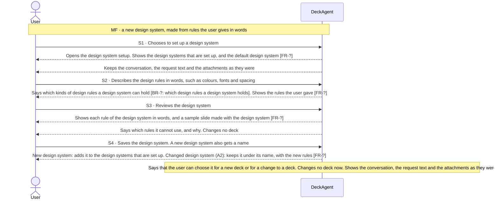
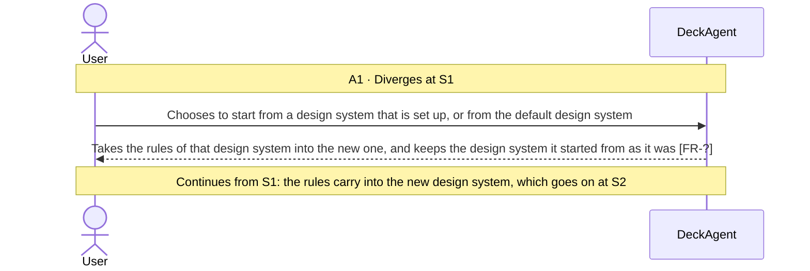
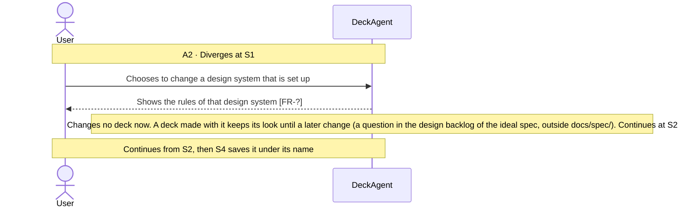
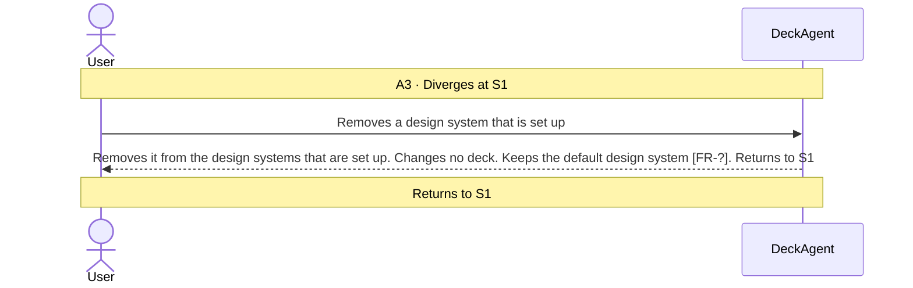
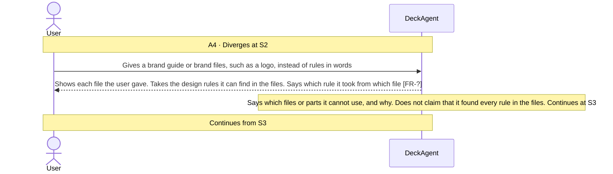
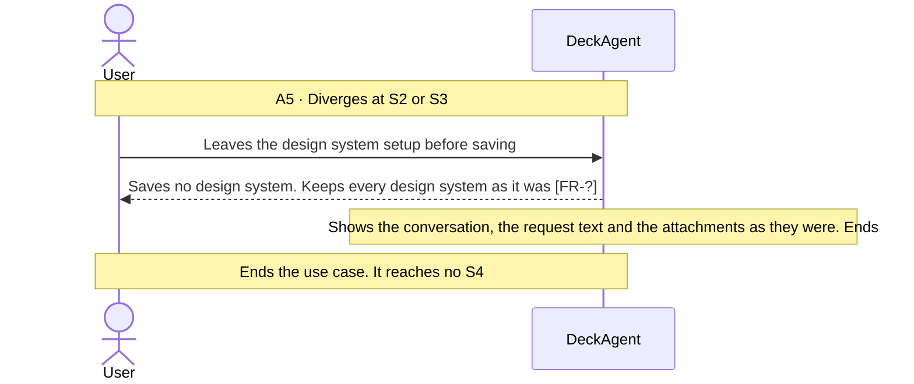
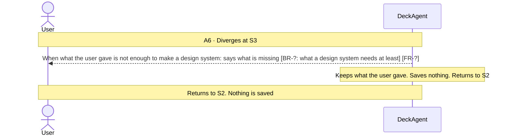
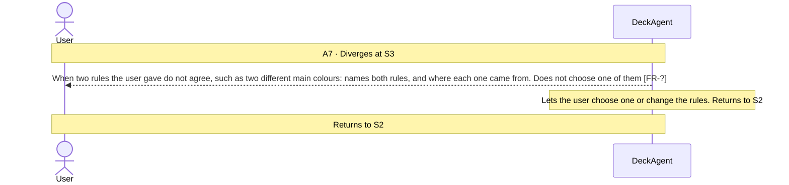

Updated at: 26-10-2026

<!-- A use case models the ideal product (UCG-01 in 03-use-cases/_CRITERIA.md). Every flow it holds is a
     behavior selected for the ideal product; this use case records no rejected options. A version file
     under docs/versions/ names the flows it takes; the use case holds no versions field (UCG-09).
     Write in plain English: docs/spec/_STYLE.md (UCG-11).
     Write intent and response, never interface (UCG-13, _STYLE rule 10). Open questions live in the
     design backlog of the ideal spec, outside docs/spec/. -->

## Goal

The user makes decks that must follow the same look, such as a company brand or a client's brand. They want that look set up once, so they can choose it for any deck, without describing the colours, fonts and rules again in every request.

## Preconditions

- **Trigger:** The user chooses to set up a design system. An example is while preparing a first draft (UC-001 A35).
- **Preconditions:** DeckAgent runs on the user's computer.

## Interactions

How to read the interactions:

- A design system is a set of design rules the user can use for many decks. Examples are colours, fonts, a logo and spacing.
- The main flow makes a new design system from rules the user gives in words. This use case makes and changes design systems. It builds no deck and changes no deck.
- Choosing a design system for a first draft is UC-001 A5. Choosing one for a deck that exists is UC-002.
- A design system is not a look for one deck; a look chosen during a first draft (UC-001 A36) is not saved as a design system (Note 2).
- The user reaches this setup from a request, for example while preparing a first draft (UC-001 A35), or from the design systems that are set up. Choosing a design system there is UC-001 A5 (UC-002 for a deck that exists). Choosing or setting one up fixes no look of any one deck (Note 2).
- How and where the system keeps a design system is not part of this use case.

### Main Flow (MF)

### Alternative Flows

#### A1 · Start from a design system that is set up

#### A2 · Change a design system that is set up

#### A3 · Remove a design system

#### A4 · Give a brand guide or brand files

#### A5 · Leave without saving

#### A6 · Not enough to make a design system

#### A7 · Design rules do not agree

## Behavior constraints

- This use case builds no deck and changes no deck; every branch leaves each deck as it was.
- The default design system stays (UC-001 Note 1). Design systems sit beside it (Note 3).

- **Postconditions:**
  - Main flow and A1: the new design system is among those the user can choose for a deck.
  - A2: the changed design system has the new rules, under the same name.
  - A3: the design system is no longer among them.
  - No deck changed.
- **Minimal guarantee:** Whatever branch fails or is left:
  - No deck changes.
  - Every design system set up before is as it was, except one the user removed or changed and saved.
  - The conversation, the request text and the attachments are as they were.

## Notes

1. Setting up a design system and choosing one are different goals. This use case sets up. UC-001 A5 and UC-002 choose one for a deck.
2. A design system is not a look for one deck. A look chosen during a first draft (UC-001 A36) is not saved as a design system.
3. UC-001 Note 1 proposes a fixed default design system. This use case adds design systems beside it. It does not change the default.
4. Design choice for an ADR proposal: the system keeps each design system so the user can choose it later. How it keeps it is an ADR matter.
5. A design system does not promise that every slide follows every rule. Whether the system checks a deck against its rules is open.
