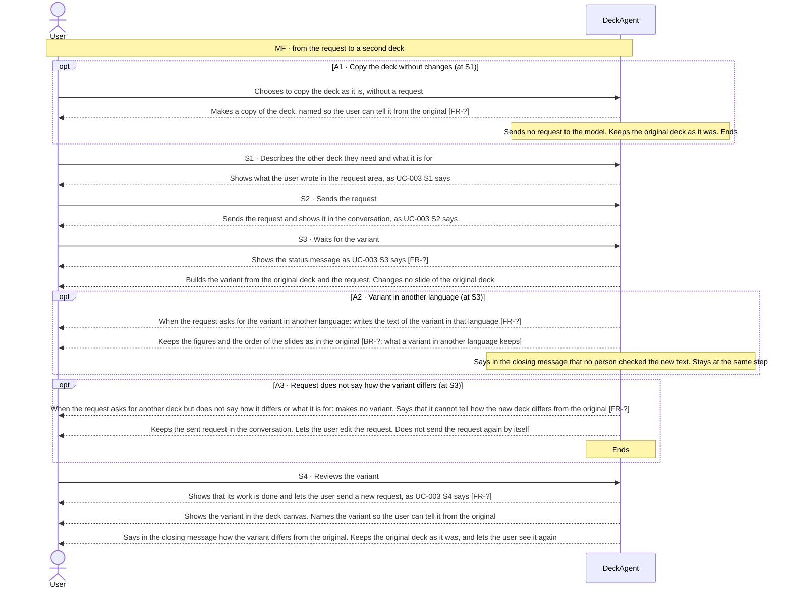

Updated at: 26-10-2026

<!-- A use case models the ideal product (UCG-01 in 03-use-cases/_CRITERIA.md). Every flow it holds is a
     behavior selected for the ideal product; this use case records no rejected options. A version file
     under docs/versions/ names the flows it takes; the use case holds no versions field (UCG-09).
     Write in plain English: docs/spec/_STYLE.md (UCG-11).
     Write intent and response, never interface (UCG-13, _STYLE rule 10). Open questions live in the
     design backlog of the ideal spec, outside docs/spec/. -->

## Goal

The user has a deck and needs a second one from it for another use: a deck to present and a deck to read, a deck in another language, or a deck for a client and one for the team. They want to keep the first deck as it is and not build the second deck from nothing.

## Preconditions

- **Trigger:** The user sends a request for another deck made from the deck in the chat.
- **Preconditions:** The deck has at least one slide. The chat has no active request: no request the system works on or waits an answer in. A request in another chat does not block this one (FR-014).

## Interactions

How to read the interactions:

- S1 to S3 run the main flow of UC-003 (`includes` UC-003). The request is prepared and sent there, and the system works there. S4 ends the request, as UC-003 S4 says, and also shows the new deck.
- The new deck is a **variant**. The deck it comes from is the **original**. The original stays as it was. A variant is not a deck state (UC-008, Note 1).
- Where the system keeps the variant, in this chat or in another one, is open (Decisions needed).

### Making the variant (S1 to S4)

## Behavior constraints

- The original deck stays as it was whatever the branch does; a failure or a stop at S3 runs the flow of UC-003 for it (A11, A18, A19, A31; Note 4).
- This use case makes a second deck; it is not UC-002, which changes the deck in place (Note 2). A look chosen in UC-001 A36 makes one deck and no variant (Note 3).
- What happens to a variant that is half made is open (Note 4).

- **Postconditions:**
  - Main flow and A1: there are two decks. The original is as it was.
  - The conversation holds the request and the closing message, except in A1.
- **Minimal guarantee:** Whatever branch fails or is interrupted:
  - The original deck is as it was.
  - The request text is kept in the conversation.

## Notes

1. A variant is not a deck state. A deck state is the same deck at another moment (UC-008). A variant is another deck that exists beside the original.
2. This use case is not UC-002. UC-002 changes the deck in place. This use case keeps the original and makes a second deck.
3. A look chosen in UC-001 A36 makes one deck. Trying looks there makes no variant.
4. A failure or a stop at S3 runs the flow of UC-003 for it: A11, A18, A19 or A31. The original deck stays as it was in each of them. What happens to a variant that is half made is a question in the design backlog of the ideal spec.
5. Whether a later change to one deck reaches the other is a question in the design backlog of the ideal spec.
