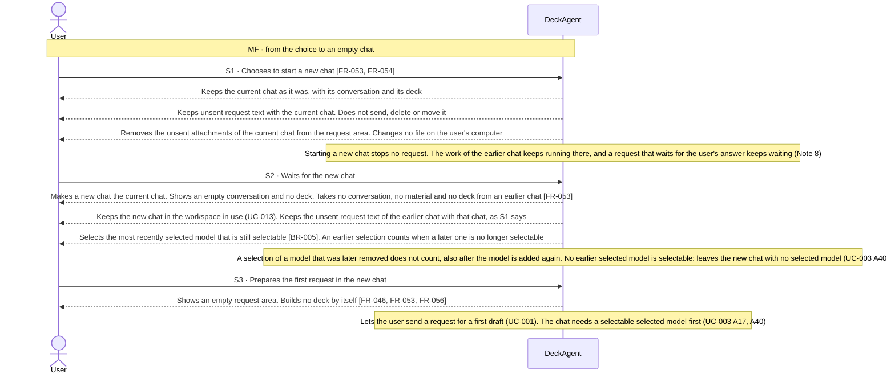

Updated at: 25-10-2026

<!-- A use case models the ideal product. Active interactions describe the product-level
     exchanges DeckAgent is designed to perform; their IDs (MF, Sx, Ax) stay stable and are
     cited by other files (UCG-03, UCG-10). A Closed flow would be listed briefly; this use
     case records none. A version file under docs/versions/ names the flows it takes; the
     use case holds no versions field (UCG-09). Write in plain English: docs/spec/_STYLE.md (UCG-11).
     Write intent and response, never interface (UCG-13, _STYLE rule 11). -->

## Goal

The user worked on one deck, or left it, and now wants to make another one. They want the new work free of the earlier conversation, material and deck, and want to start without setting anything up first.

## Preconditions

- **Trigger:** The user chooses to start a new chat in the current workspace.
- **Preconditions:** DeckAgent runs on the user's computer. A chat holds at most one request that the system works on or waits an answer in. A request in another chat does not block starting a new chat (Note 8).
- **Evidence:** [assumed]

## Active interactions

Every flow below is Active in the ideal product; this use case records no Closed flow. Nothing here says which version takes a flow. The use case has no alternative flows (Note 5).

How to read the interactions:

- A chat holds a conversation and the work on its deck. A new chat starts with neither. The earlier chat stays as it was; reopening it later is UC-006.
- The new chat joins the chats of the workspace in use (UC-013). The chats of a workspace are what the user sees as earlier work.
- The user starts a new chat while a request runs anywhere. The work of that request keeps running in the chat it belongs to (UC-006 A5).
- These actions differ: starting a new chat, opening an earlier chat (UC-006), reloading the product (UC-003 A13), closing DeckAgent, and stopping a request (UC-003 A31). A decision about one does not decide another (Note 6).
- How the system keeps a chat is not part of this use case.

### Starting the new chat (S1 to S3)

- All main-flow steps: [assumed]

## Behavior constraints

- Starting a new chat changes no chat; the earlier chat stays as it was whatever fails.
- A chat holds one deck. A new deck starts in a new chat (Note 7).
- Starting a new chat stops no request and moves no work to the background. The work of the earlier chat keeps running in that chat (Note 8). The user returns to it and sees it as it stands (UC-006 A5).

Proposals, to be confirmed against recordings.

- **Postconditions:**
  - A new chat is the current chat.
  - It holds no conversation, no material and no deck from an earlier chat.
  - The earlier chat is as it was.
  - The user can start a first draft in the new chat (UC-001).
- **Minimal guarantee:** Whatever fails:
  - The earlier chat is as it was.
- **Evidence:** [assumed]

## Product evidence

### Claude Slide Design

- **Coverage:** unverified
- **Research card:** [claude-deck-generation-behavior](../../research/use-cases/claude-slides-design/claude-deck-generation-behavior.md)
- **Difference:**
  - The team did not record starting a new chat.
- **Updated at:** 11-10-2026

### Napkin AI

- **Coverage:** unverified
- **Research card:** [napkin-ai-deck-generation-behavior](../../research/use-cases/napkin-ai/napkin-ai-deck-generation-behavior.md)
- **Difference:**
  - A screenshot shows a new chat. How the user started it was not recorded.
- **Updated at:** 11-10-2026

## Decisions needed

Resolved — the owner decisions are recorded in Notes. Each entry below keeps its old number and names its note:

1. Settled (owner, 2026-10-13): unsent request text stays with the earlier chat. Unsent attachments are removed (S1, Note 7).
2. Settled (owner, 2026-10-13): a chat with no sent request need not appear among earlier chats (Note 7) [BR-004].

## Notes

1. Design decision (owner, 2026-10-11): starting a new chat is a use case of its own.
   - It is not UC-001. UC-001 drafts a deck in a chat that has none. Starting a chat drafts nothing.
   - It is not UC-006. UC-006 goes back to earlier work. Here the user leaves it for new work.
   - Considered: an alternative flow of UC-001; the offer to start a new chat in UC-006 A1. Neither is selected.
   - Why: not recorded. This note takes no flow.
2. Design decision (owner, 2026-10-11): one default workspace, and a new chat for another deck (option B).
   - Considered: one chat only (option A), not selected; folder-based workspaces (option C), a future candidate with no version assigned.
   - Why: the user can begin new deck work without choosing a folder or managing workspaces. Folder-based workspaces may later give more control over how chats and their resources are organized.
   - Option C does not mean that a chosen folder gives access to every file in it. It assumes no storage design.
   - A version file under `docs/versions/` records which flows it takes. This note takes none.
   - Since 2026-10-25, the owner approved folder-based workspaces for the ideal product (Note 8). Adding and organizing them is UC-013. A first start still needs no folder: it uses the default workspace.
3. A chat and a workspace are different. A chat holds one line of work: its conversation and its deck. A workspace is where chats are organized. The user never sets one up. Since 2026-10-25: the user can add workspaces by choosing a folder (UC-013); a first start uses the default workspace.
4. Design decision (owner, 2026-10-11, extended the same day): the user cannot start a new chat while a request in the current chat is active.
   - A request that waits for the user's answer is active (UC-003 A38 and Note 22). This settles the earlier open question about that wait.
   - After the request finished, stopped or failed, the user can start a new chat.
   - The system does not stop the request to start a chat, and does not move it to the background.
   - Opening an earlier chat follows the same rule (UC-006 Note 8).
5. No alternative flow: S1 to S3 send nothing to the model, and the user gives no input that the system can reject.
6. These actions differ: starting a new chat, opening an earlier chat (UC-006), reloading the product (UC-003 A13), closing DeckAgent, and stopping a request (UC-003 A31). A decision about one does not decide another.
7. Design decisions (owner, 2026-10-13): unsent text and empty chats.
   - Unsent request text stays with the chat in which the user wrote it. Starting a new chat does not send, delete or move it (S1).
   - Unsent attachments leave the request area and do not come back with the earlier chat. No file on the user's computer changes.
   - While DeckAgent runs, reopening the earlier chat shows that text again (UC-006 Note 9).
   - A chat with no sent request need not appear among earlier chats [BR-004].
   - A chat holds one deck. A new deck starts in a new chat.
   - This settles open questions 1 and 2. S1 follows this note since 2026-10-13. Why: not recorded. This note takes no flow.
8. Design decision (owner, 2026-10-25): the user can start a new chat while a request is active (switching during work).
   - It supersedes Note 4 in the ideal product. Note 4 stays as history.
   - Starting a new chat does not stop, pause or move the request of the earlier chat. Its work keeps running in that chat, also a request that waits for the user's answer.
   - A chat still holds at most one request that the system works on or waits an answer in (UC-003).
   - The new chat joins the chats of the workspace in use (UC-013, owner decision, 2026-10-25).
   - Which version takes this is a scope decision, not a product-design status. This note takes no flow.
