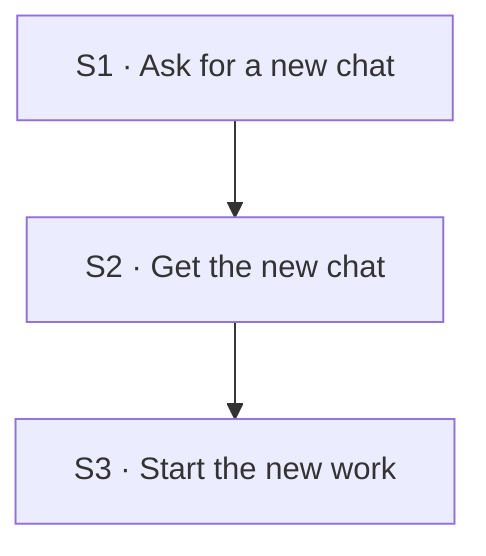

## Flow at a glance

<!-- BEGIN generated: use-case-flowchart -->

*Solid arrows are the main flow. Dotted arrows are alternative flows, labelled with their IDs.*
*Not drawn (the flow stays at the same step): none.*
<!-- END generated: use-case-flowchart -->

## Situation and goal

- The user worked on one deck, or left it, and now wants to make another one.
- The user wants the new work free of the earlier conversation, material and deck.
- The user wants to start without setting anything up first.

## Trigger and preconditions

- **Trigger:** The user chooses to start a new chat.
- **Preconditions:** No request in the current chat is active. A request is active while the system works on it or waits for the user's answer (UC-003 A38).
- **Evidence:** [assumed]

## Main flow

- A chat holds a conversation and the work on its deck. A new chat starts with neither.
- The earlier chat stays as it was. Reopening it later is UC-006.
- How the system keeps a chat is not part of this use case.

### S1 · Ask for a new chat

- **User:** Chooses to start a new chat.
- **System:**
  - Keeps the current chat as it was, with its conversation and its deck.
  - Keeps unsent request text with the current chat. Does not send, delete or move it.
  - Removes the unsent attachments of the current chat from the request area. Changes no file on the user's computer.
  - Lets the user start a new chat only while no request in the current chat is active. A request that waits for the user's answer is active.
- **Reqs:** FR-053, FR-054
- **Evidence:** [assumed]
- **Updated at:** 13-10-2026

### S2 · Get the new chat

- **User:** Waits.
- **System:**
  - Makes a new chat the current chat.
  - Shows an empty conversation and no deck.
  - Takes no conversation, no material and no deck from an earlier chat.
  - Selects the most recently selected model that is still selectable [BR-005]. An earlier selection counts when a later one is no longer selectable.
  - A selection of a model that was later removed does not count, also after the model is added again.
  - No earlier selected model is selectable: leaves the new chat with no selected model (UC-003 A40).
- **Reqs:** FR-053
- **Evidence:** [assumed]
- **Updated at:** 12-10-2026

### S3 · Start the new work

- **User:** Prepares the first request in the new chat.
- **System:**
  - Shows an empty request area.
  - Lets the user send a request for a first draft (UC-001). The chat needs a selectable selected model first (UC-003 A17, A40).
  - Builds no deck by itself.
- **Reqs:** FR-046, FR-053, FR-056
- **Evidence:** [assumed]
- **Updated at:** 12-10-2026

## Alternative flows

No alternative flow (Note 5).

## Postconditions and minimal guarantee

Proposals, to be confirmed against recordings.

- **Postconditions:**
  - A new chat is the current chat.
  - It holds no conversation, no material and no deck from an earlier chat.
  - The earlier chat is as it was.
  - The user can start a first draft in the new chat (UC-001).
- **Minimal guarantee:** Whatever fails:
  - The earlier chat is as it was.
- **Evidence:** [assumed]

## Product evidence

### Claude Slide Design

- **Coverage:** unverified
- **Research card:** [claude-deck-generation-behavior](../../research/use-cases/claude-slides-design/claude-deck-generation-behavior.md)
- **Difference:**
  - The team did not record starting a new chat.
- **Updated at:** 11-10-2026

### Napkin AI

- **Coverage:** unverified
- **Research card:** [napkin-ai-deck-generation-behavior](../../research/use-cases/napkin-ai/napkin-ai-deck-generation-behavior.md)
- **Difference:**
  - A screenshot shows a new chat. How the user started it was not recorded.
- **Updated at:** 11-10-2026

## Open questions

1. Settled (owner, 2026-10-13): unsent request text stays with the earlier chat. Unsent attachments are removed (S1, Note 7).
2. Settled (owner, 2026-10-13): a chat with no sent request need not appear among earlier chats (Note 7) [BR-004].

## Notes

1. Design decision (owner, 2026-10-11): starting a new chat is a use case of its own.
   - It is not UC-001. UC-001 drafts a deck in a chat that has none. Starting a chat drafts nothing.
   - It is not UC-006. UC-006 goes back to earlier work. Here the user leaves it for new work.
   - Considered: an alternative flow of UC-001; the offer to start a new chat in UC-006 A1. Neither is selected.
   - Why: not recorded. This note takes no flow.
2. Design decision (owner, 2026-10-11): one default workspace, and a new chat for another deck (option B).
   - Considered: one chat only (option A), not selected; folder-based workspaces (option C), a future candidate with no version assigned.
   - Why: the user can begin new deck work without choosing a folder or managing workspaces. Folder-based workspaces may later give more control over how chats and their resources are organized.
   - Option C does not mean that a chosen folder gives access to every file in it. It assumes no storage design.
   - A version file under `docs/versions/` records which flows it takes. This note takes none.
3. A chat and a workspace are different. A chat holds one line of work: its conversation and its deck. A workspace is where chats are organized. The user never sets one up.
4. Design decision (owner, 2026-10-11, extended the same day): the user cannot start a new chat while a request in the current chat is active.
   - A request that waits for the user's answer is active (UC-003 A38 and Note 22). This settles the earlier open question about that wait.
   - After the request finished, stopped or failed, the user can start a new chat.
   - The system does not stop the request to start a chat, and does not move it to the background.
   - Opening an earlier chat follows the same rule (UC-006 Note 8).
5. No alternative flow: S1 to S3 send nothing to the model, and the user gives no input that the system can reject.
6. These actions differ: starting a new chat, opening an earlier chat (UC-006), reloading the product (UC-003 A13), closing DeckAgent, and stopping a request (UC-003 A31). A decision about one does not decide another.
7. Design decisions (owner, 2026-10-13): unsent text and empty chats.
   - Unsent request text stays with the chat in which the user wrote it. Starting a new chat does not send, delete or move it (S1).
   - Unsent attachments leave the request area and do not come back with the earlier chat. No file on the user's computer changes.
   - While DeckAgent runs, reopening the earlier chat shows that text again (UC-006 Note 9).
   - A chat with no sent request need not appear among earlier chats [BR-004].
   - A chat holds one deck. A new deck starts in a new chat.
   - This settles open questions 1 and 2. S1 follows this note since 2026-10-13. Why: not recorded. This note takes no flow.
