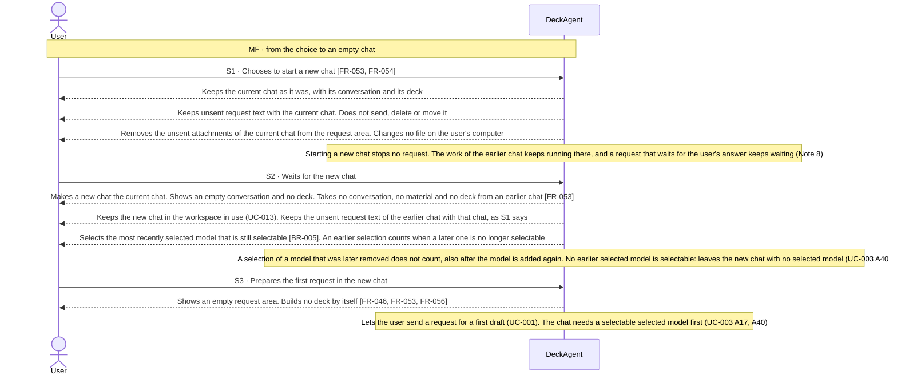

Updated at: 25-10-2026

<!-- A use case models the ideal product (UCG-01 in 03-use-cases/_CRITERIA.md). Every flow it holds is a
     behavior selected for the ideal product; this use case records no rejected options. A version file
     under docs/versions/ names the flows it takes; the use case holds no versions field (UCG-09).
     Write in plain English: docs/spec/_STYLE.md (UCG-11).
     Write intent and response, never interface (UCG-13, _STYLE rule 10). Open questions live in the
     design backlog of the ideal spec, outside docs/spec/. -->

## Goal

The user worked on one deck, or left it, and now wants to make another one. They want the new work free of the earlier conversation, material and deck, and want to start without setting anything up first.

## Preconditions

- **Trigger:** The user chooses to start a new chat in the current workspace.
- **Preconditions:** DeckAgent runs on the user's computer. A chat holds at most one request that the system works on or waits an answer in. A request in another chat does not block starting a new chat (Note 8).

## Interactions

How to read the interactions:

- A chat holds a conversation and the work on its deck. A new chat starts with neither. The earlier chat stays as it was; reopening it later is UC-006.
- The new chat joins the chats of the workspace in use (UC-013). The chats of a workspace are what the user sees as earlier work.
- The user starts a new chat while a request runs anywhere. The work of that request keeps running in the chat it belongs to (UC-006 A5).
- These actions differ: starting a new chat, opening an earlier chat (UC-006), reloading the product (UC-003 A13), closing DeckAgent, and stopping a request (UC-003 A31). A decision about one does not decide another (Note 6).
- How the system keeps a chat is not part of this use case.

### Starting the new chat (S1 to S3)

## Behavior constraints

- Starting a new chat changes no chat; the earlier chat stays as it was whatever fails.
- A chat holds one deck. A new deck starts in a new chat (Note 7).
- Starting a new chat stops no request and moves no work to the background. The work of the earlier chat keeps running in that chat (Note 8). The user returns to it and sees it as it stands (UC-006 A5).

- **Postconditions:**
  - A new chat is the current chat.
  - It holds no conversation, no material and no deck from an earlier chat.
  - The earlier chat is as it was.
  - The user can start a first draft in the new chat (UC-001).
- **Minimal guarantee:** Whatever fails:
  - The earlier chat is as it was.

## Notes

1. Starting a new chat is a use case of its own.
   - It is not UC-001. UC-001 drafts a deck in a chat that has none. Starting a chat drafts nothing.
   - It is not UC-006. UC-006 goes back to earlier work. Here the user leaves it for new work.
   - It is not an alternative of UC-001 and not an offer inside UC-006.
2. A first start needs no folder: it uses the default workspace (UC-013). The user can add workspaces of folders beside it; adding and organizing them is UC-013.
3. A chat and a workspace are different. A chat holds one line of work: its conversation and its deck. A workspace groups the chats of a project. The new chat joins the chats of the workspace in use (UC-013).
4. A new chat starts in a chat with no active request. The user can start it while a request is active in another chat (Note 8, FR-054). A request that waits for the user's answer is active (UC-003 A38 and Note 22).
5. No alternative flow: S1 to S3 send nothing to the model, and the user gives no input that the system can reject.
6. These actions differ: starting a new chat, opening an earlier chat (UC-006), reloading the product (UC-003 A13), closing DeckAgent, and stopping a request (UC-003 A31). A decision about one does not decide another.
7. Unsent text and empty chats:
   - Unsent request text stays with the chat in which the user wrote it. Starting a new chat does not send, delete or move it (S1). While DeckAgent runs, reopening the earlier chat shows that text again (UC-006 Note 9).
   - Unsent attachments leave the request area and do not come back with the earlier chat. No file on the user's computer changes.
   - A chat with no sent request need not appear among earlier chats [BR-004]. Whether an empty new chat counts among earlier chats is a value of BR-004.
   - A chat holds one deck. A new deck starts in a new chat.
8. The user can start a new chat while a request is active in another chat (FR-054). Starting a new chat does not stop, pause or move that request. Its work keeps running in its chat, also a request that waits for the user's answer. A chat still holds at most one request that the system works on or waits an answer in (UC-003).
