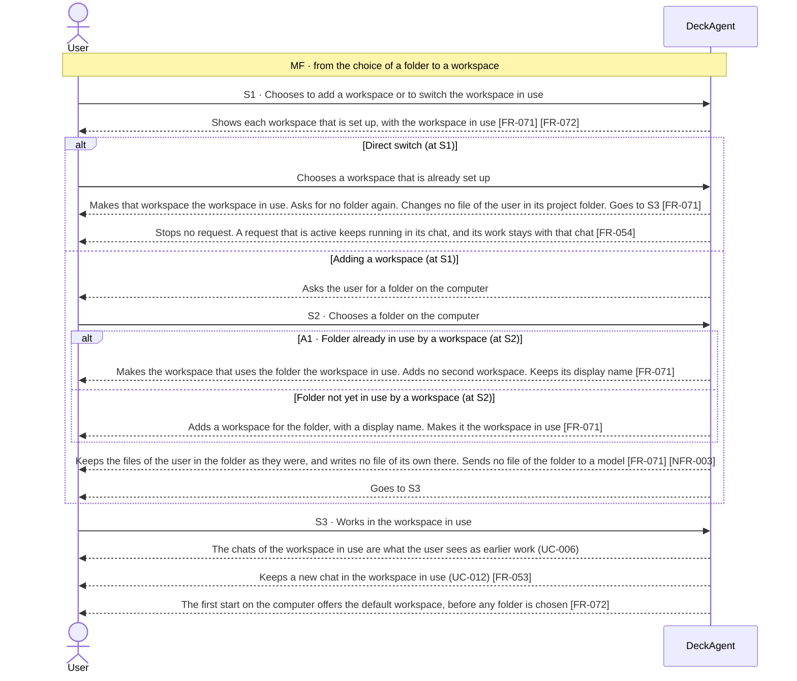
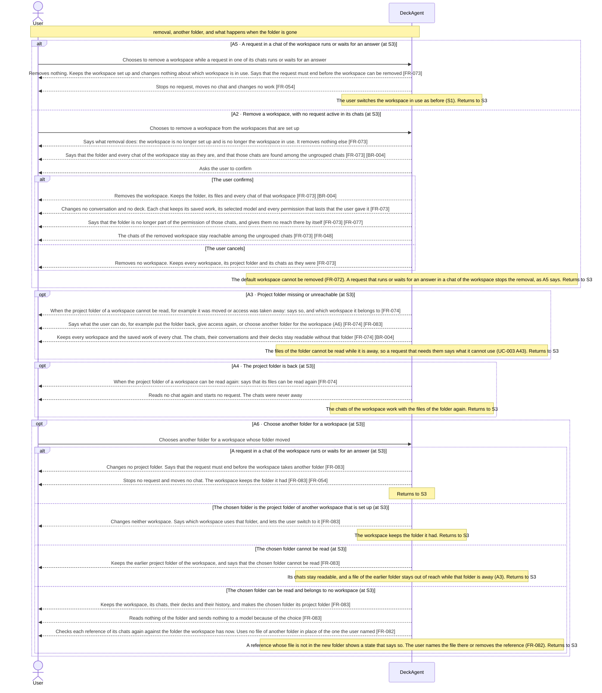

Updated at: 26-10-2026

<!-- A use case models the ideal product (UCG-01 in 03-use-cases/_CRITERIA.md). Every flow it holds is a
     behavior selected for the ideal product; this use case records no rejected options. A version file
     under docs/versions/ names the flows it takes; the use case holds no versions field (UCG-09).
     Write in plain English: docs/spec/_STYLE.md (UCG-11).
     Write intent and response, never interface (UCG-13, _STYLE rule 10). Open questions live in the
     design backlog of the ideal spec, outside docs/spec/. -->

## Goal

The user keeps work for different projects in different folders on their computer. They want the chats of each project grouped under a workspace named for it, so they find each chat with its project and reach it again. They also want to start working before having chosen any folder.

## Preconditions

- **Trigger:** The user chooses to add a workspace, to switch the workspace in use, to give a workspace another folder, or to remove one.
- **Preconditions:** DeckAgent runs on the user's computer. The chats, conversations and decks of earlier work are kept [BR-004].

## Interactions

How to read the interactions:

- A **workspace** groups chats for one project folder. The user adds one by choosing a folder. Choosing the same folder again returns the workspace that already uses it.
- Switching the workspace in use among the workspaces that are set up needs no folder. It is part of S1.
- A first start needs no folder: it uses the **default workspace** (Note 1). It has no project folder and cannot be removed.
- A workspace holds the chats that belong to it. Opening an earlier chat of the workspace in use is UC-006. Starting a new chat is UC-012.
- A request that runs or waits for an answer in a chat of a workspace keeps that workspace from being removed and from taking another folder (A5, A6). Switching the workspace in use stops no request (S1) [FR-054].
- Choosing a folder sets up a workspace for it. The files of the user in that folder are then inside the permission of the chats of the workspace (UC-014) [NFR-003]. The folder holds none of the work DeckAgent saves: the chats, their conversations and their decks stay available without it (Note 6).
- How the system keeps workspaces is not part of this use case.

### Adding and switching workspaces (S1 to S3)

### Removing a workspace, changing its folder, and a missing folder (A2 to A6)

## Behavior constraints

- Adding, switching and removing workspaces changes no file of the user on the computer. DeckAgent writes no file of its own work into a project folder (Note 6).
- The default workspace is usable at the first start and cannot be removed (Note 1) [FR-072].
- Removing a workspace keeps its chats reachable among the ungrouped chats [BR-004] [FR-073]. The system deletes no chat, conversation or deck when a project folder cannot be read.
- Removing a workspace takes its folder out of the permission of its chats. Each chat keeps its saved work, its selected model and every permission that lasts that the user gave it, and the folder it used to reach is inside no chat's permission afterwards. The system gives no chat that reach by itself [FR-077] [FR-073].
- The work DeckAgent saved for a workspace stays available when its project folder is missing, moved, replaced or gone. A file of the folder that a request needs cannot be read while the folder is away (Note 7) [FR-074].
- A project folder chosen for a workspace puts the files of the user in it inside the permission of the chats of that workspace. That permission gives no reach outside the folder, and no change to a file of the user in it (UC-014) [FR-077] [NFR-003].
- No request stops because the user switches the workspace in use, removes a workspace, or loses a project folder [FR-054].

- **Postconditions:**
  - Main flow: the workspace in use is the one the user chose. The files of the user in the project folder are as they were.
  - Direct switch and A1: no second workspace for the folder. The user is asked for no folder again. A request that was active kept running in its chat.
  - A2 confirmed, with no request active in its chats: the workspace is no longer set up. Its chats are among the ungrouped chats, with their conversations, their decks and their selected models, and they keep every permission that lasts.
  - A2 cancelled: every workspace is as it was.
  - A3: the workspace stays set up, its chats stay readable, and the user knows what to do.
  - A4: the files of the project folder can be read again.
  - A5: no workspace is removed, and the request keeps running.
  - A6: after a choice that succeeds, the workspace keeps its chats and has the chosen folder, and its references are checked against that folder. A refused or failed choice leaves the earlier folder in place.
- **Minimal guarantee:** Whatever branch fails:
  - No file of the user is changed, moved or deleted. The system deletes no chat, conversation or deck.
  - No request stops because the user adds, switches or removes a workspace, or gives one another folder.

## Notes

1. Folder workspaces are part of the ideal product. The user adds a workspace by choosing one folder; switching needs no folder again; removing a workspace removes no folder, no file, no chat and no history, and its chats stay reachable (A2). A first start needs no folder: it uses the default workspace, which has no folder and cannot be removed.
2. Each workspace other than the default workspace stands for exactly one project folder. No workspace holds two folders, and two workspaces hold no folder in common.
3. The project folder of a workspace is inside the permission of the chats of that workspace. No place outside it is. Naming a workspace is not a full-access permission. What a chat reaches is FR-077 and NFR-003 (UC-014).
4. How the system keeps workspaces, how a workspace names its project folder, and how it keeps the saved work of a workspace apart from that folder, are ADR matters.
5. A chat that was used before workspaces were set up belongs to no added workspace. It stays reachable among the ungrouped chats, as A2 says for the chats of a removed workspace.
6. A project folder holds the files of the user. DeckAgent writes none of its own work there: the conversation, the outline, the deck and the record of each request are kept for the chat, and they stay available when the folder does not. Ordinary work creates, changes and deletes no file of the user in that folder [FR-084]. Only an export the user chooses can put a new file there (UC-004).
7. A project folder that cannot be read takes away the files of the user, not the work of the chats. The chats, their conversations and their decks stay readable (A3). A file of the folder that a request needs cannot be read while the folder is away, and the request says what it cannot use (UC-003 A43). When the folder is gone for good, the system promises no return of a file the user put there, and it claims no copy of one.
8. Switching the workspace in use changes no file of the user and stops no request. A request that is active keeps running in its chat, and its work stays with that chat (S1, FR-054). The switch applies to the work the user starts next.
9. Giving a workspace another folder keeps that workspace. It is the same workspace, with the same chats, decks and history, and the folder the user chose is its project folder (A6, FR-083). Removing a workspace ends it: it is no longer set up. Choosing that folder again sets up a new workspace with no chat of its own, and the chats of the removed one stay among the ungrouped chats (A2, FR-073) [FR-071]. Neither removal nor another folder moves a chat into another workspace, also not into the default workspace.
