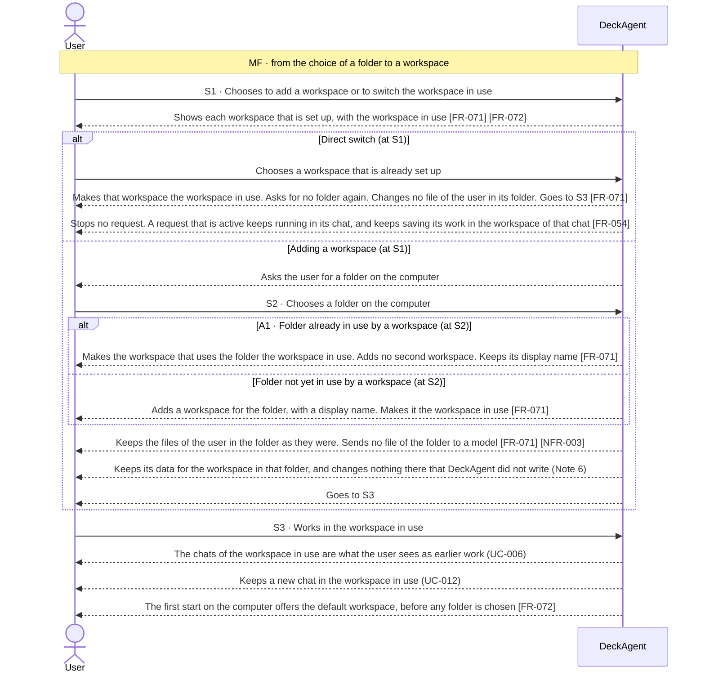
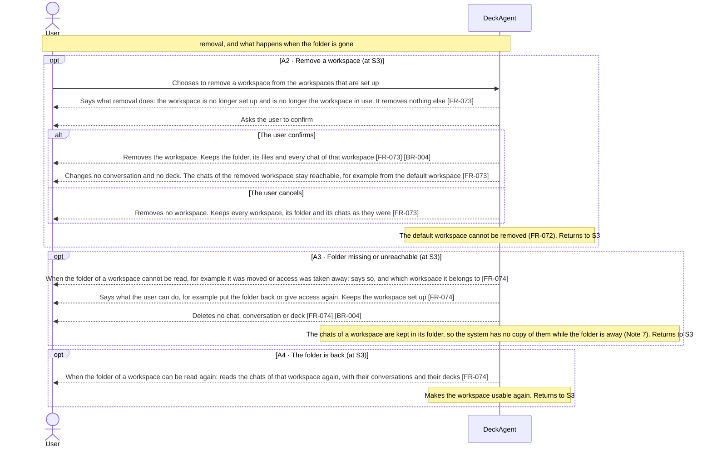

Updated at: 26-10-2026

<!-- A use case models the ideal product (UCG-01 in 03-use-cases/_CRITERIA.md). Every flow it holds is a
     behavior selected for the ideal product; this use case records no rejected options. A version file
     under docs/versions/ names the flows it takes; the use case holds no versions field (UCG-09).
     Write in plain English: docs/spec/_STYLE.md (UCG-11).
     Write intent and response, never interface (UCG-13, _STYLE rule 10). Open questions live in the
     design backlog of the ideal spec, outside docs/spec/. -->

## Goal

The user keeps work for different projects in different folders on their computer. They want the chats of each project grouped under a workspace named for it, so they find each chat with its project and reach it again. They also want to start working before having chosen any folder.

## Preconditions

- **Trigger:** The user chooses to add a workspace, to switch the workspace in use, or to remove one.
- **Preconditions:** DeckAgent runs on the user's computer. The chats, conversations and decks of earlier work are kept [BR-004].

## Interactions

How to read the interactions:

- A **workspace** groups chats on the user's computer. The user adds one by choosing a folder. Choosing the same folder again returns the workspace that already uses it.
- Switching the workspace in use among the workspaces that are set up needs no folder. It is part of S1.
- A first start needs no folder: it uses the **default workspace** (Note 1). It cannot be removed.
- A workspace holds the chats that belong to it. Opening an earlier chat of the workspace in use is UC-006. Starting a new chat is UC-012.
- Choosing a folder sets up a workspace for it. The files of the user in that folder are then inside the permission of the chats of the workspace (UC-014) [NFR-003]. DeckAgent also keeps its data for the workspace in that folder (Note 6).
- How the system keeps workspaces is not part of this use case.

### Adding and switching workspaces (S1 to S3)

### Removing a workspace, a missing folder, and the folder that comes back (A2, A3, A4)

## Behavior constraints

- Adding, switching and removing workspaces changes no file of the user on the computer. DeckAgent writes only its own workspace data, and changes nothing in the folder that it did not write (Note 6).
- The default workspace is usable at the first start and cannot be removed (Note 1) [FR-072].
- Removing a workspace keeps its chats reachable [BR-004]. The system deletes no chat, conversation or deck when a folder cannot be read.
- The chats of a workspace are kept in its folder. When that folder and the data in it are gone, the system claims no copy of those chats (Note 7) [FR-074].
- A folder chosen as a workspace puts the files of the user in that folder inside the permission of the chats of that workspace. That permission gives no reach outside the folder, and no change to a file of the user in it (UC-014) [FR-077] [NFR-003].

- **Postconditions:**
  - Main flow: the workspace in use is the one the user chose. The files of the user in the folder are as they were.
  - Direct switch and A1: no second workspace for the folder. The user is asked for no folder again. A request that was active kept running in its chat.
  - A2 confirmed: the workspace is no longer set up. Its chats are reachable.
  - A2 cancelled: every workspace is as it was.
  - A3: the workspace stays set up, and the user knows what to do.
  - A4: the chats of the workspace are readable again, with their conversations and their decks.
- **Minimal guarantee:** Whatever branch fails:
  - No file of the user is changed, moved or deleted. The system deletes no chat, conversation or deck.

## Notes

1. Folder workspaces are part of the ideal product. The user adds a workspace by choosing a folder; switching needs no folder again; removing a workspace removes no folder, no file, no chat and no history, and its chats stay reachable (A2). A first start needs no folder: it uses the default workspace, which cannot be removed.
2. Whether adding the same folder again as a workspace binds the chats it had is an open question. It is kept in the design backlog of the ideal spec, outside `docs/spec/`.
3. The folder of a workspace is inside the permission of the chats of that workspace. No place outside it is. Naming a workspace is not a full-access permission. What a chat reaches is FR-077 and NFR-003 (UC-014).
4. How the system keeps workspaces, and how a workspace names its folder, are ADR matters.
5. A chat that was used before workspaces were set up belongs to no added workspace. It stays reachable, as A2 says for the chats of a removed workspace.
6. A workspace has two kinds of content in its folder. The files of the user are theirs: DeckAgent never changes, overwrites or deletes them, and adding, switching or removing a workspace keeps them as they were. The workspace data is what DeckAgent keeps for the chats of the workspace. DeckAgent writes it as the product works, and changes nothing in the folder that it did not write. What the system does when the place it uses for that data already holds content it did not write is an open question, kept in the design backlog of the ideal spec. How the data is laid out is an ADR matter.
7. The chats of a workspace are kept in its folder, so the folder that cannot be read takes them with it for as long as it is away (A3). When the folder and the data in it are gone for good, for example the user deleted it, the system has no copy of those chats and promises none (A3, FR-074). It keeps the workspace among the workspaces that are set up and says that its folder cannot be read. BR-004 sets that a loss DeckAgent did not cause stays outside its promise. Whether the product keeps a copy of workspace data outside its folder, for example as a backup, is an open question kept in the design backlog of the ideal spec.
8. Switching the workspace in use changes no file of the user and stops no request. A request that is active keeps running in its chat, and its work keeps being saved in the workspace of that chat (S1, FR-054). The switch applies to the work the user starts next.
