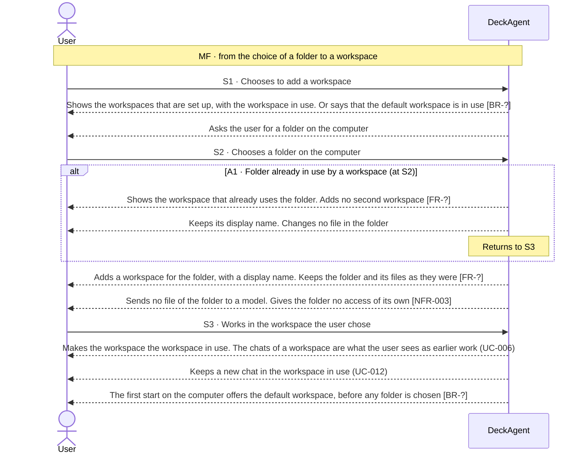
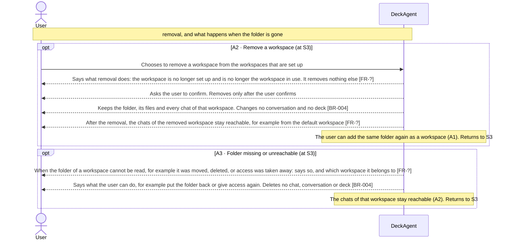

Updated at: 25-10-2026

<!-- A use case models the ideal product. Active interactions describe the product-level
     exchanges DeckAgent is designed to perform; their IDs (MF, Sx, Ax) stay stable and are
     cited by other files (UCG-03, UCG-10). A Closed flow would be listed briefly; this use
     case records none. A version file under docs/versions/ names the flows it takes; the
     use case holds no versions field (UCG-09). Write in plain English: docs/spec/_STYLE.md (UCG-11).
     Write intent and response, never interface (UCG-13, _STYLE rule 11). -->

## Goal

The user keeps work for different projects in different folders on their computer. They want the chats of each project grouped under a workspace named for it, so they find each chat with its project and reach it again. They also want to start working before having chosen any folder.

## Preconditions

- **Trigger:** The user chooses to add a workspace, to switch the workspace in use, or to remove one.
- **Preconditions:** DeckAgent runs on the user's computer. The chats, conversations and decks of earlier work are kept [BR-004].
- **Evidence:** [assumed]

## Active interactions

Every flow below is Active in the ideal product; this use case records no Closed flow. Nothing here says which version takes a flow.

How to read the interactions:

- A **workspace** groups chats on the user's computer. The user adds one by choosing a folder. Choosing the same folder again shows the workspace that already uses it.
- A first start needs no folder: it uses the **default workspace** (Note 1).
- A workspace holds the chats that belong to it. Opening an earlier chat of the workspace in use is UC-006. Starting a new chat is UC-012.
- Choosing a folder is not a permission. What the agent of a chat can reach is UC-014 [NFR-003].
- How the system keeps workspaces is not part of this use case.

### Adding and switching workspaces (S1 to S3)

- All main-flow steps: [assumed]
- **A1:** [assumed]

### Removing a workspace, and a missing folder (A2, A3)

- **A2:** [assumed]
- **A3:** [assumed]

## Behavior constraints

- Adding, switching and removing workspaces changes no folder and no file on the user's computer.
- Removing a workspace keeps its chats reachable [BR-004]. A missing folder destroys no chat, conversation or deck.
- A folder chosen as a workspace gives the agent no access by itself. The permission of the chat decides what the agent reaches (UC-014) [NFR-003].

Proposals, to be confirmed against recordings.

- **Postconditions:**
  - Main flow: the workspace is set up and is the workspace in use. The folder and its files are as they were.
  - A1: no second workspace for the folder.
  - A2: the workspace is no longer set up. Its chats are reachable.
  - A3: the chats of the workspace are reachable, and the user knows what to do.
- **Minimal guarantee:** Whatever branch fails:
  - No folder, file, chat, conversation or deck is changed, moved or deleted.
- **Evidence:** [assumed]

## Product evidence

### Claude Slide Design

- **Coverage:** unverified
- **Research card:** [claude-deck-generation-behavior](../../research/use-cases/claude-slides-design/claude-deck-generation-behavior.md)
- **Difference:**
  - The recorded product holds the chats in one place. The team recorded no workspaces of folders.
- **Updated at:** 25-10-2026

### Napkin AI

- **Coverage:** unverified
- **Research card:** [napkin-ai-deck-generation-behavior](../../research/use-cases/napkin-ai/napkin-ai-deck-generation-behavior.md)
- **Difference:**
  - The team recorded no grouping of decks into workspaces.
- **Updated at:** 25-10-2026

## Decisions needed

1. S1: what display name a new workspace gets, and whether the user can change it later. Owner to decide [BR-?].
2. S1, S3: which workspaces the product sets up by default besides the default workspace, if any. Owner to decide [BR-?].
3. A2: where the chats of a removed workspace appear. Removing a workspace keeps them reachable; the default workspace is one example. Owner to decide [FR-?].

## Notes

1. Design decision (owner, 2026-10-25): workspaces of folders are part of the ideal product.
   - The user adds a workspace by choosing a folder. Choosing a folder again opens the workspace that uses it. Removing a workspace removes no folder, no file, no chat and no history; its chats stay reachable (A2).
   - A first start needs no folder: it uses the default workspace.
   - Considered earlier (owner, 2026-10-11): one default workspace with no folder use (UC-012 Note 2). That decision stays as history; this note adds folder workspaces beside it.
   - Which versions take this is a scope decision. This note takes no flow.
2. A chosen folder gives the agent no access by itself. Naming a workspace is not naming a permission. The permission of the chat decides (UC-014, owner decision of 2026-10-25).
3. How the system keeps workspaces, and how a workspace names its folder, are ADR matters.
4. A chat that was used before workspaces were set up belongs to no added workspace. It stays reachable, as A2 says for the chats of a removed workspace.
