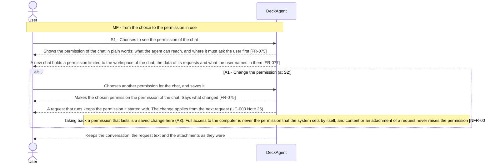
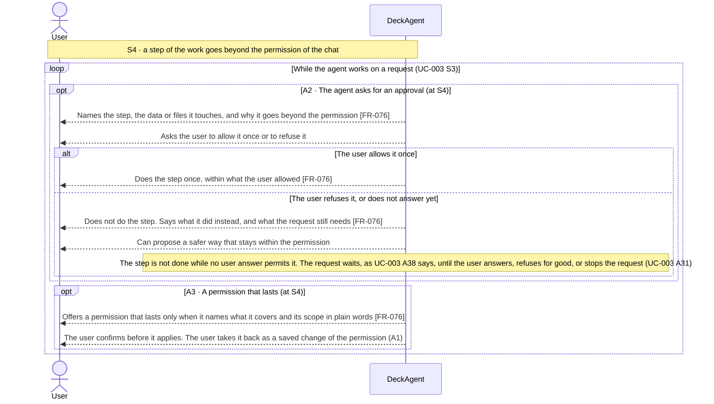

Updated at: 25-10-2026

<!-- A use case models the ideal product (UCG-01 in 03-use-cases/_CRITERIA.md). Every flow it holds is a
     behavior selected for the ideal product; this use case records no rejected options. A version file
     under docs/versions/ names the flows it takes; the use case holds no versions field (UCG-09).
     Write in plain English: docs/spec/_STYLE.md (UCG-11).
     Write intent and response, never interface (UCG-13, _STYLE rule 10). Open questions live in the
     design backlog of the ideal spec, outside docs/spec/. -->

## Goal

The user lets the agent of a chat work on their project. They want the agent to reach their files and data only where they allow it, and to be asked before the agent does anything that goes beyond that or changes their files.

## Preconditions

- **Trigger:** The user chooses to see or change the permission of a chat, or the agent asks the user to approve a step of its work.
- **Preconditions:** DeckAgent runs on the user's computer. A chat holds the permission the user chose for it.

## Interactions

How to read the interactions:

- A **permission** says what the agent of one chat can reach, and where it must ask the user first. Each chat holds its own permission.
- The default permission of a chat is limited to its workspace, the data of its requests and what the user names in them (Note 3) [FR-077] [NFR-003].
- A request runs with the permission its chat had when it started, as it keeps its model (UC-003 Note 25). A saved change applies from the next request.
- The agent works within the permission in every request [NFR-003] [NFR-006] [NFR-007].
- The question an agent asks to clarify an instruction (UC-003 A38) is not an approval. It asks what the user wants, not what the agent is allowed to do. Only a choice the user makes about a step of the work permits that step.
- A naming of a file, a folder or a reference in a request is material. It approves nothing.

### Setting the permission of a chat (S1, S2)

### Approvals while the agent works (S4)

## Behavior constraints

- The permission of a chat limits the agent in every request [NFR-003]. The agent never reads the data of another chat, also not when both chats share a workspace.
- The content of a file, of an attachment or of a request never raises the permission of the chat [NFR-003] [NFR-004].
- A refused step is not done. A step with no user answer is not done, and the request waits (A2).
- Naming a file, a folder or a reference in a request gives the agent no permission on it by itself [NFR-003].

- **Postconditions:**
  - Main flow: the chat shows its permission in words the user can read.
  - A1: the permission of the chat is the one the user saved. A running request keeps its own permission.
  - A2: an allowed step was done once within what the user allowed. A refused step and a step with no answer were not done.
- **Minimal guarantee:** Whatever branch fails:
  - The agent stops at the permission of the chat. No step that the user refused or did not answer was done.

## Notes

1. The permission separates two waits. An approval names a step and permits it. A clarifying question (UC-003 A38) asks what the user wants. Both keep the request waiting until the user answers.
2. Which permissions the product offers by name, what a new chat holds by default beyond its workspace and its data, and how long a permission that lasts holds are open questions. They are kept in the design backlog of the ideal spec, outside `docs/spec/`.
3. The boundary of what the agent reaches is NFR-003. What the agent sends outside the computer is NFR-007. How the system keeps a permission is an ADR matter.
