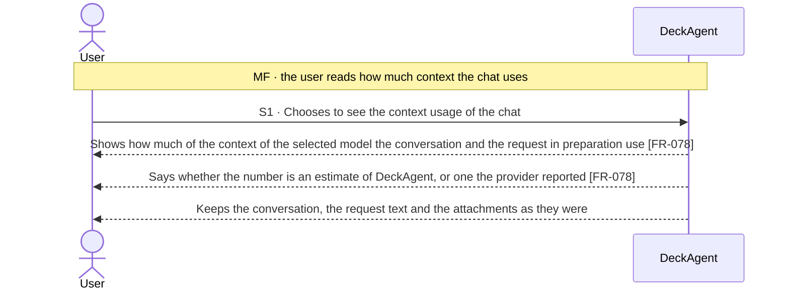
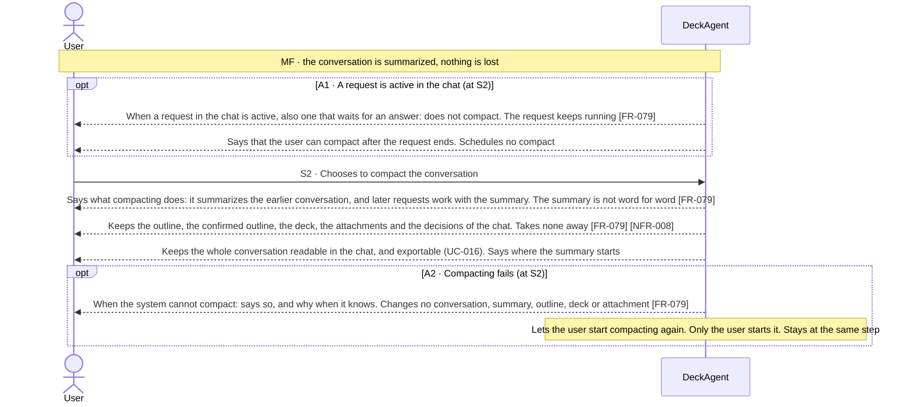

Updated at: 25-10-2026

<!-- A use case models the ideal product (UCG-01 in 03-use-cases/_CRITERIA.md). Every flow it holds is a
     behavior selected for the ideal product; this use case records no rejected options. A version file
     under docs/versions/ names the flows it takes; the use case holds no versions field (UCG-09).
     Write in plain English: docs/spec/_STYLE.md (UCG-11).
     Write intent and response, never interface (UCG-13, _STYLE rule 10). Open questions live in the
     design backlog of the ideal spec, outside docs/spec/. -->

## Goal

The user works in a chat whose conversation has grown long. They want to know how much of the context of the selected model the chat uses, and to keep the work going within that context when it fills up, without losing any result of the chat.

## Preconditions

- **Trigger:** The user chooses to see the context usage of the chat, or to compact the conversation.
- **Preconditions:** The chat has a selected model that is selectable (UC-003 A17, A40).

## Interactions

How to read the interactions:

- The **context usage** says how much of the context of the selected model the conversation and the request in preparation use.
- A **compact** summarizes the earlier conversation, so the work of the next requests stays within the context of the selected model. The whole conversation stays readable, and nothing the chat holds is lost (Note 3).
- Compacting is a choice of the user. Only the user starts it, and the system schedules none (Note 1).
- The conversation and the work of a request are UC-003. Exporting the conversation and the session archive is UC-016.

### Seeing the context usage (S1)

### Compacting the conversation (S2)

## Behavior constraints

- Compacting changes what later requests use as context. It changes no conversation the user reads, no outline, no deck and no attachment.
- The summary is not the conversation word for word. The system promises no detail it did not keep; the whole conversation stays readable, so nothing the user reads is lost (Note 2).
- Compacting takes no decision of the chat away. The whole conversation stays readable and exportable (UC-016).
- Only the user starts a compact. No compact runs while a request in the chat is active, and the system schedules none (A1).

- **Postconditions:**
  - Main flow: later requests work with the summary. The whole conversation is still readable, and nothing the chat holds was taken away.
  - A1: nothing was compacted while the request ran, and the user was told when compacting is possible.
  - A2: nothing changed.
- **Minimal guarantee:** Whatever branch fails:
  - The conversation, the outline, the confirmed outline, the deck, the attachments and the decisions of the chat stay as they were.

## Notes

1. Compact is a choice of the user. The system runs none by itself and schedules none; after a compact is refused because a request is active, the user tries again when the request has ended.
2. How a summary is made, and how it is kept, are ADR matters. NFR-008 protects the last saved state of the chat. What a compact must keep is a behavior matter of this use case; no size, rate or threshold is set here.
3. Whether compacting asks before applying, whether the provider reports exact usage, and whether the system offers compacting of its own when the context is nearly full, are open questions. They are kept in the design backlog of the ideal spec, outside `docs/spec/`.
