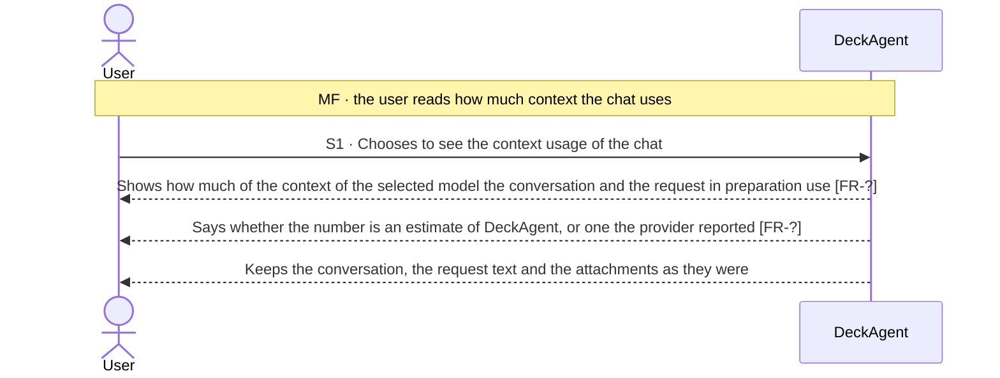
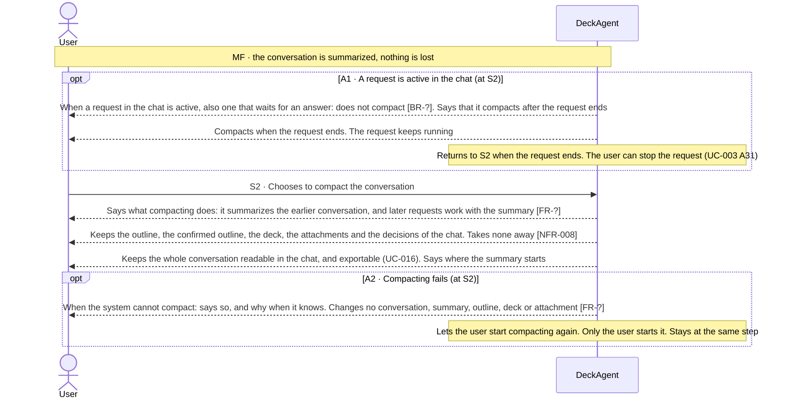

Updated at: 25-10-2026

<!-- A use case models the ideal product. Active interactions describe the product-level
     exchanges DeckAgent is designed to perform; their IDs (MF, Sx, Ax) stay stable and are
     cited by other files (UCG-03, UCG-10). A Closed flow would be listed briefly; this use
     case records none. A version file under docs/versions/ names the flows it takes; the
     use case holds no versions field (UCG-09). Write in plain English: docs/spec/_STYLE.md (UCG-11).
     Write intent and response, never interface (UCG-13, _STYLE rule 11). -->

## Goal

The user works in a chat whose conversation has grown long. They want to know how much of the context of the selected model the chat uses, and to keep the work going within that context when it fills up, without losing any result of the chat.

## Preconditions

- **Trigger:** The user chooses to see the context usage of the chat, or to compact the conversation.
- **Preconditions:** The chat has a selected model that is selectable (UC-003 A17, A40).
- **Evidence:** [assumed]

## Active interactions

Every flow below is Active in the ideal product; this use case records no Closed flow. Nothing here says which version takes a flow.

How to read the interactions:

- The **context usage** says how much of the context of the selected model the conversation and the request in preparation use.
- A **compact** summarizes the earlier conversation, so the work of the next requests stays within the context of the selected model. The whole conversation stays readable, and nothing the chat holds is lost (Note 3).
- The conversation and the work of a request are UC-003. Exporting the conversation and the session archive is UC-016.

### Seeing the context usage (S1)

- **MF S1:** [assumed]

### Compacting the conversation (S2)

- **MF S2:** [assumed]
- **A1:** [assumed]
- **A2:** [assumed]

## Behavior constraints

- Compacting changes what later requests use as context. It changes no conversation the user reads, no outline, no deck and no attachment.
- Compacting takes no decision of the chat away. The whole conversation stays readable and exportable (UC-016).
- No compact runs while a request in the chat is active (A1).

Proposals, to be confirmed against recordings.

- **Postconditions:**
  - Main flow: later requests work with the summary. The whole conversation is still readable, and nothing the chat holds was taken away.
  - A1: the compact ran after the request ended.
  - A2: nothing changed.
- **Minimal guarantee:** Whatever branch fails:
  - The conversation, the outline, the confirmed outline, the deck, the attachments and the decisions of the chat stay as they were.
- **Evidence:** [assumed]

## Product evidence

### Claude Slide Design

- **Coverage:** unverified
- **Research card:** [claude-deck-generation-behavior](../../research/use-cases/claude-slides-design/claude-deck-generation-behavior.md)
- **Difference:**
  - The team recorded no context usage and no compacting of a conversation.
- **Updated at:** 25-10-2026

### Napkin AI

- **Coverage:** unverified
- **Research card:** [napkin-ai-deck-generation-behavior](../../research/use-cases/napkin-ai/napkin-ai-deck-generation-behavior.md)
- **Difference:**
  - The team recorded no context usage and no compacting of a conversation.
- **Updated at:** 25-10-2026

## Decisions needed

1. S2: does compacting ask the user before later requests work with the summary, or does the user's choice to compact stand for that? Owner to decide.
2. S1: does the provider report a context usage for each of its models, and which of the numbers shown are exact? Owner to decide [NFR-?].
3. Whether the system offers compacting of its own when the context is nearly full stays open. No flow here does it. Owner to decide.

## Notes

1. Design decision (owner, 2026-10-25): the product shows the context usage of the chat, and compacts the conversation on the user's choice.
   - The usage shown distinguishes an estimate of DeckAgent from a number the provider reported (S1).
   - A compact summarizes the earlier conversation. The original conversation stays readable and exportable (UC-016). A compact never takes a deck, an outline, an attachment or a decision away.
   - No compact runs while a request of the chat is active (A1).
   - No goal mode and no queue of requests are added: no owner decision asks for them.
   - Which versions take this is a scope decision. This note takes no flow.
2. How a summary is made, and how it is kept, are ADR matters. NFR-008 protects the last saved state of the chat.
3. What a compact must keep is a behavior matter of this use case; what it must not lose is the line above. No size, rate or threshold is set here.
