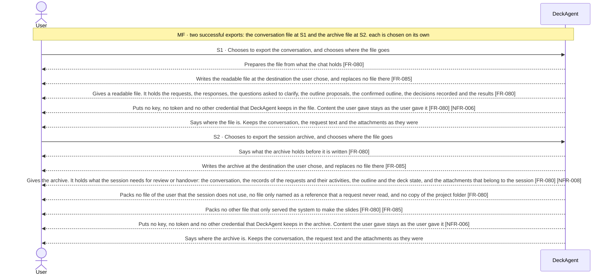
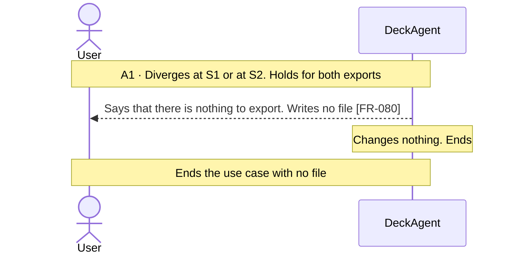
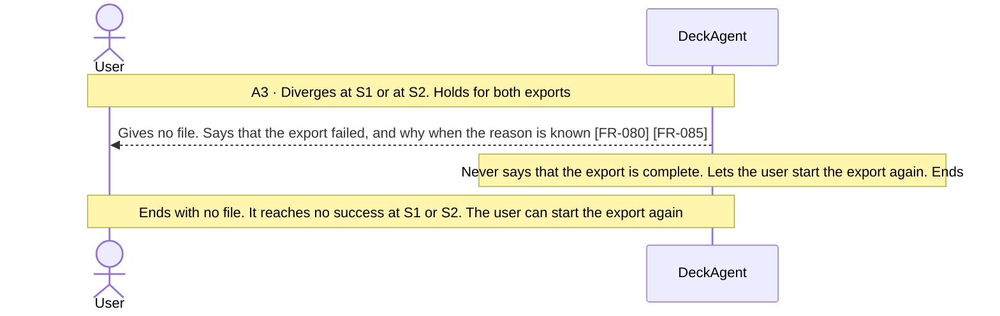
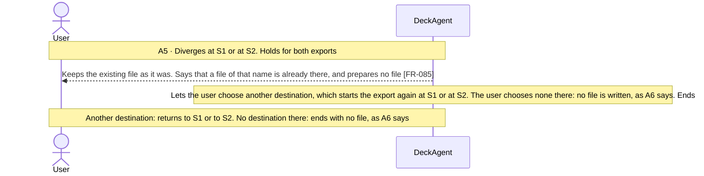
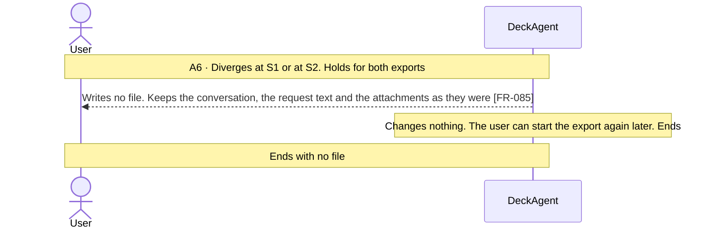

Updated at: 28-10-2026

<!-- A use case models the ideal product (UCG-01 in 03-use-cases/_CRITERIA.md). Every flow it holds is a
     behavior selected for the ideal product; this use case records no rejected options. A version file
     under docs/versions/ names the flows it takes; the use case holds no versions field (UCG-09).
     Write in plain English: docs/spec/_STYLE.md (UCG-11).
     Write intent and response, never interface (UCG-13, _STYLE rule 10). Open questions live in the
     design backlog of the ideal spec, outside docs/spec/. -->

## Goal

The user wants a record of the work in a chat outside DeckAgent: to read the conversation and the results somewhere else, or to hand the session over with its records and attachments. They want no credential that DeckAgent keeps in the record, and no change in the chat.

## Preconditions

- **Trigger:** The user chooses to export the conversation or the session archive of a chat.
- **Preconditions:** DeckAgent runs on the user's computer. A1 covers a chat that holds no sent request.

## Interactions

How to read the interactions:

- The conversation export is one readable file for reading. The session archive is one packaged file for review or handover.
- The user chooses where the file goes. A project folder of a workspace can be that destination, but a workspace being set up chooses none [FR-085].
- The export writes what the chat holds. It needs no project folder: a folder that cannot be read takes nothing out of the export, and the system reads no file of it again to make one.
- Getting the deck of the chat as a source archive or as PDF, PNG or JPEG files is UC-004. That ability is not replaced by this use case.
- What the system writes into a file of an export is also bounded by NFR-006: no key reaches data that DeckAgent writes outside the place where it keeps keys.
- The product does not import an archive and builds no chat from it. Such a behavior is not part of the ideal product (Note 2).

### Main Flow (MF)

### Alternative Flows

#### A1 · No sent request

#### A3 · Export fails

#### A5 · The destination already holds a file of that name

#### A6 · The user chooses no destination

## Behavior constraints

- No export changes the chat; whatever fails, the user can start the export again (A3).
- An export that fails is never reported as complete (A3).
- No export holds a key, a token or another credential that DeckAgent keeps [NFR-006]. Content the user gave stays as the user gave it (Note 4).
- The export writes one file at the destination the user chose. It replaces no existing file, and a cancelled choice writes none (Note 6) [FR-085].
- The archive holds the session and what belongs to it. It does not hold every file of the user in the project folder, and it holds nothing the user did not choose to export.
- The export needs no project folder. A chat that is readable is exported with what it holds, and a part of the session that cannot be read fails the export instead of being claimed (Note 7).
- The archive is a record for reading and handover. The product imports no archive and builds no chat from it (Note 2).

- **Postconditions:**
  - Main flow: the user has the file, at the destination the user chose. The chat is as it was.
  - A1: no file was written.
  - A3: no finished file was written, and the user was told that the export failed.
  - A5: the file that was already there is as it was, and no export file was written.
  - A6: no file was written, and the chat is as it was.
- **Minimal guarantee:** Whatever branch fails:
  - The chat, its conversation and its deck stay as they were.
  - The system never says that an export finished when it did not.

## Notes

1. The session export is a conversation file and a session archive. The conversation export is a readable file for the user. The session archive is one packaged file for review and handover. Getting the deck as a file stays UC-004. The two exports are different abilities.
2. Import and restore of an archive are not behaviors of the ideal product. The flow ID A4 that described them is retired and never reused (use-case criteria, Retired flow IDs). Whether the product should have a backup or migration ability is a question kept in the design backlog of the ideal spec, outside `docs/spec/`.
3. How the system builds the files of an export, and which format each holds, are ADR matters. What an export holds is bounded by NFR-006 and NFR-007.
4. The export keeps out every credential DeckAgent keeps: a key, a token and anything else it stores for a provider. It removes nothing from the content the user gave. A file that holds a password therefore reaches the export as the user gave it, and the product promises no search for a secret inside that content. Whether an export says so before it writes the file is a question kept in the design backlog of the ideal spec, outside `docs/spec/`.
5. A1, A3, A5 and A6 hold for both exports. Each diagram shows the outcome it starts from.
6. The user chooses where the file goes (FR-085). The project folder of a workspace is one destination among others: a workspace being set up chooses no destination. A destination that already holds a file of that name keeps it, and the user chooses another one there or none at all (A5). A choice the user cancels writes no file and leaves the chat as it was (A6).
7. The export writes what the session holds, so it needs no project folder. A folder that cannot be read takes no part out of the export, and the system reads none of its files to make one. When a part of the session that the export needs cannot be read, the export fails and says no more than it knows (FR-080).
