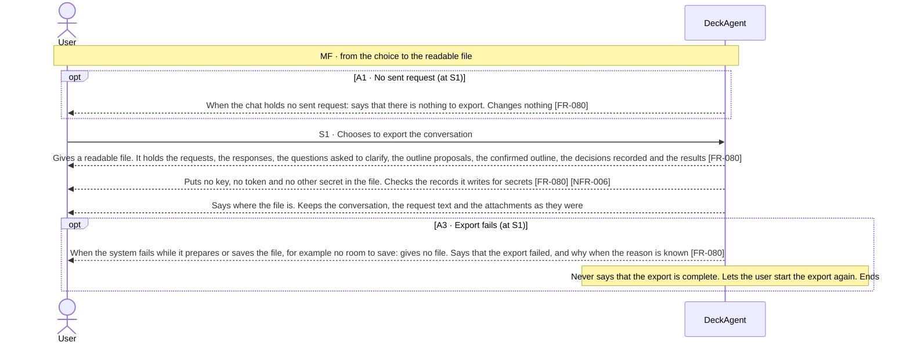
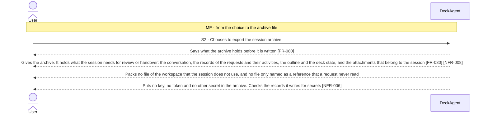

Updated at: 25-10-2026

<!-- A use case models the ideal product (UCG-01 in 03-use-cases/_CRITERIA.md). Every flow it holds is a
     behavior selected for the ideal product; this use case records no rejected options. A version file
     under docs/versions/ names the flows it takes; the use case holds no versions field (UCG-09).
     Write in plain English: docs/spec/_STYLE.md (UCG-11).
     Write intent and response, never interface (UCG-13, _STYLE rule 10). Open questions live in the
     design backlog of the ideal spec, outside docs/spec/. -->

## Goal

The user wants a record of the work in a chat outside DeckAgent: to read the conversation and the results somewhere else, or to hand the session over with its records and attachments. They want no secret in the record and no change in the chat.

## Preconditions

- **Trigger:** The user chooses to export the conversation or the session archive of a chat.
- **Preconditions:** DeckAgent runs on the user's computer. The chat holds at least one sent request.

## Interactions

How to read the interactions:

- The conversation export is one readable file for reading. The session archive is one packaged file for review or handover.
- Getting the deck of the chat as an editable or a fixed file is UC-004. That ability is not replaced by this use case.
- What the system writes into a file of an export is also bounded by NFR-006: no key reaches data that DeckAgent writes outside the place where it keeps keys.
- The product does not import an archive and builds no chat from it. Such a behavior is not part of the ideal product (Note 2).

### Exporting the conversation (S1)

### Exporting the session archive (S2)

## Behavior constraints

- No export changes the chat; whatever fails, the user can start the export again (A3).
- An export that fails is never reported as complete (A3).
- No export holds a key, a token or another secret [NFR-006].
- The archive holds the session and what belongs to it. It does not hold every file of the workspace, and it holds nothing the user did not choose to export.
- The archive is a record for reading and handover. The product imports no archive and builds no chat from it (Note 2).

- **Postconditions:**
  - Main flow: the user has the file, in the place the system named. The chat is as it was.
  - A1: no file was written.
  - A3: no finished file was written, and the user was told that the export failed.
- **Minimal guarantee:** Whatever branch fails:
  - The chat, its conversation and its deck stay as they were.
  - The system never says that an export finished when it did not.

## Notes

1. The session export is a conversation file and a session archive. The conversation export is a readable file for the user. The session archive is one packaged file for review and handover. Getting the deck as a file stays UC-004. The two exports are different abilities.
2. Import and restore of an archive are not behaviors of the ideal product. The flow ID A4 that described them is retired and never reused (use-case criteria, Retired flow IDs). Whether the product should have a backup or migration ability is a question kept in the design backlog of the ideal spec, outside `docs/spec/`.
3. How the system builds the files of an export, and which format each holds, are ADR matters. What an export holds is bounded by NFR-006 and NFR-007.
