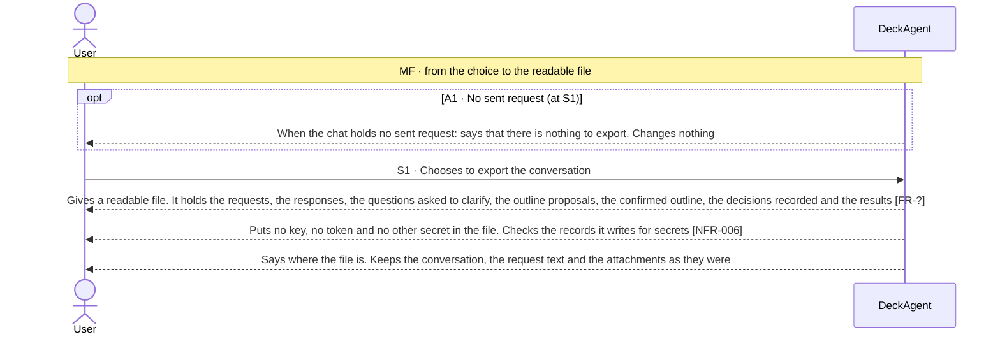
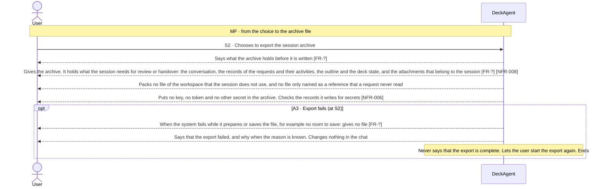

Updated at: 25-10-2026

<!-- A use case models the ideal product. Active interactions describe the product-level
     exchanges DeckAgent is designed to perform; their IDs (MF, Sx, Ax) stay stable and are
     cited by other files (UCG-03, UCG-10). A Closed flow would be listed briefly; this use
     case records none. A version file under docs/versions/ names the flows it takes; the
     use case holds no versions field (UCG-09). Write in plain English: docs/spec/_STYLE.md (UCG-11).
     Write intent and response, never interface (UCG-13, _STYLE rule 11). -->

## Goal

The user wants a record of the work in a chat outside DeckAgent: to read the conversation and the results somewhere else, or to hand the session over with its records and attachments. They want no secret in the record and no change in the chat.

## Preconditions

- **Trigger:** The user chooses to export the conversation or the session archive of a chat.
- **Preconditions:** DeckAgent runs on the user's computer. The chat holds at least one sent request.
- **Evidence:** [assumed]

## Active interactions

Every flow below is Active in the ideal product unless it is Closed. Nothing here says which version takes a flow.

How to read the interactions:

- The conversation export is one readable file for reading. The session archive is one packaged file for review or handover.
- Getting the deck of the chat as an editable or a fixed file is UC-004. That ability is not replaced by this use case.
- What the system writes into a file of an export is also bounded by NFR-006: no key reaches data that DeckAgent writes outside the place where it keeps keys.

### Exporting the conversation (S1)

- **MF S1:** [assumed]
- **A1:** [assumed]

### Exporting the session archive (S2)

- **MF S2:** [assumed]
- **A3:** [assumed]

## Behavior constraints

- No export changes the chat; whatever fails, the user can start the export again.
- No export holds a key, a token or another secret [NFR-006].
- The archive holds the session and what belongs to it. It does not hold every file of the workspace, and it holds nothing the user did not choose to export.
- The archive is a record for reading and handover. The product does not build a chat from it (Closed flow A4).

Proposals, to be confirmed against recordings.

- **Postconditions:**
  - Main flow: the user has the file, in the place the system named. The chat is as it was.
  - A1: no file was written.
  - A3: no finished file was written, and the user was told that the export failed.
- **Minimal guarantee:** Whatever branch fails:
  - The chat, its conversation and its deck stay as they were.
  - The system never says that an export finished when it did not.
- **Evidence:** [assumed]

## Closed flows

| ID | Description | Why not selected | Reconsider when / source |
|---|---|---|---|
| A4 | Import a session archive and restore a chat from it | The archive is made for review and handover, not as a backup the product restores (owner decision, 2026-10-25, Note 1) | When the owner adds a backup or a migration capability |

## Product evidence

### Claude Slide Design

- **Coverage:** unverified
- **Research card:** [claude-deck-generation-behavior](../../research/use-cases/claude-slides-design/claude-deck-generation-behavior.md)
- **Difference:**
  - The team recorded no export of a conversation or a session.
- **Updated at:** 25-10-2026

### Napkin AI

- **Coverage:** unverified
- **Research card:** [napkin-ai-deck-generation-behavior](../../research/use-cases/napkin-ai/napkin-ai-deck-generation-behavior.md)
- **Difference:**
  - The team recorded no export of a conversation or a session. The product offers an export of the deck (UC-004).
- **Updated at:** 25-10-2026

## Decisions needed

1. MF: which parts of a session the archive holds beyond the conversation, the request records, the outline and deck state and the attachments. Owner to decide [FR-?].
2. S1: what counts as a decision recorded in the conversation, and how the export marks it. Owner to decide [FR-?].
3. S1, S2: where the system puts the files of an export and how it names them. Owner to decide [FR-?].

## Notes

1. Design decision (owner, 2026-10-25): the session export is a conversation file and a session archive.
   - The conversation export is a readable file for the user. The session archive is one packaged file for review and handover.
   - No export holds a key, a token or another secret, and the records it writes are checked for secrets [NFR-006]. An export that fails says so and gives no finished file.
   - No import and no restore: the product does not build a chat from an archive (A4). It is not offered as a backup until the owner adds that.
   - Getting the deck as a file stays UC-004. The two exports are different abilities.
   - Which versions take this is a scope decision. This note takes no flow.
2. How the system builds the files of an export, and which format each holds, are ADR matters.
