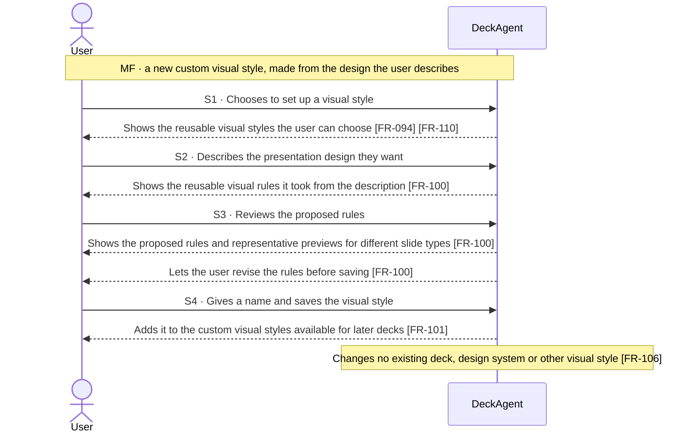
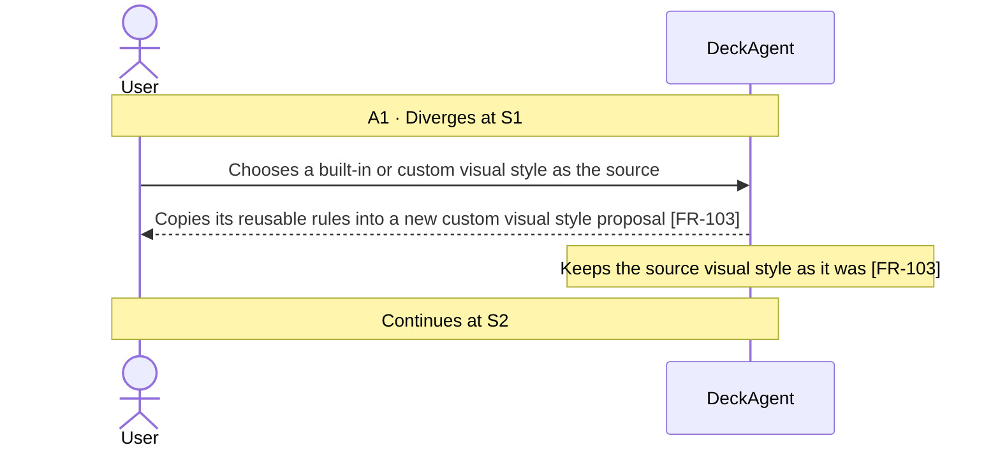
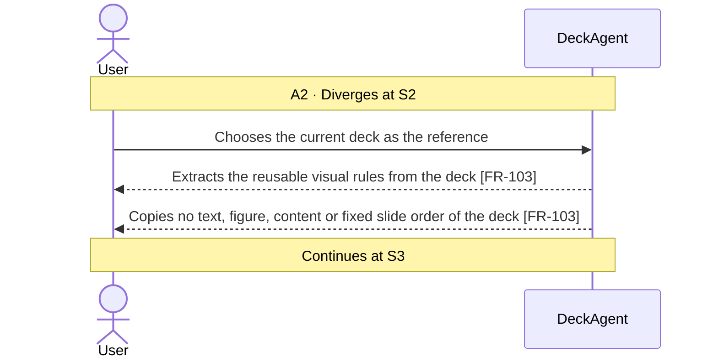
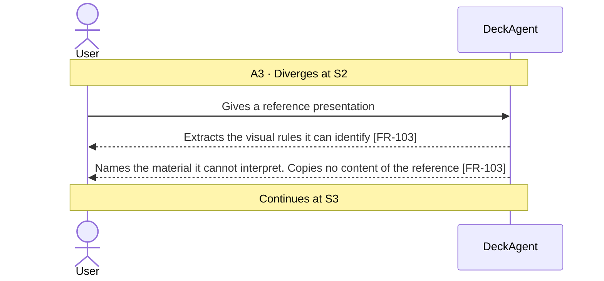
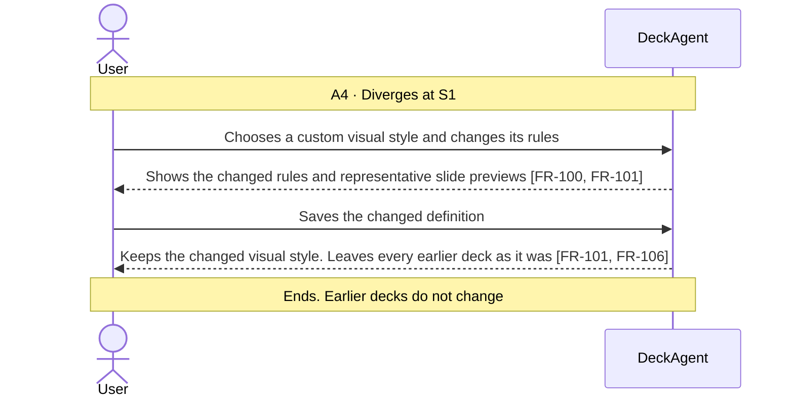
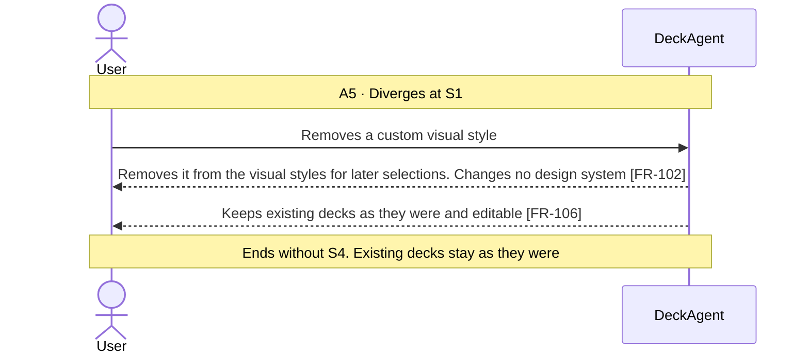
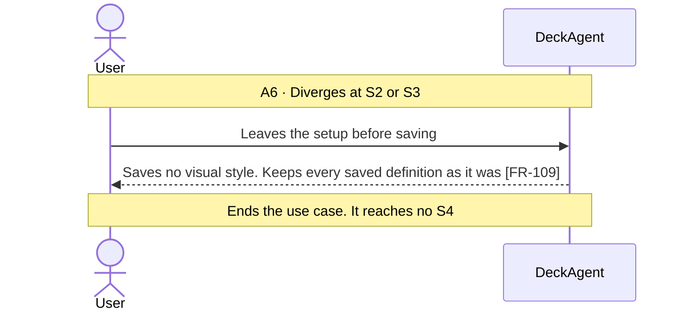
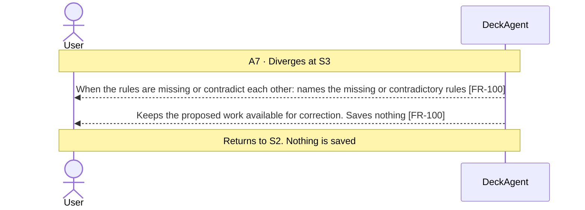
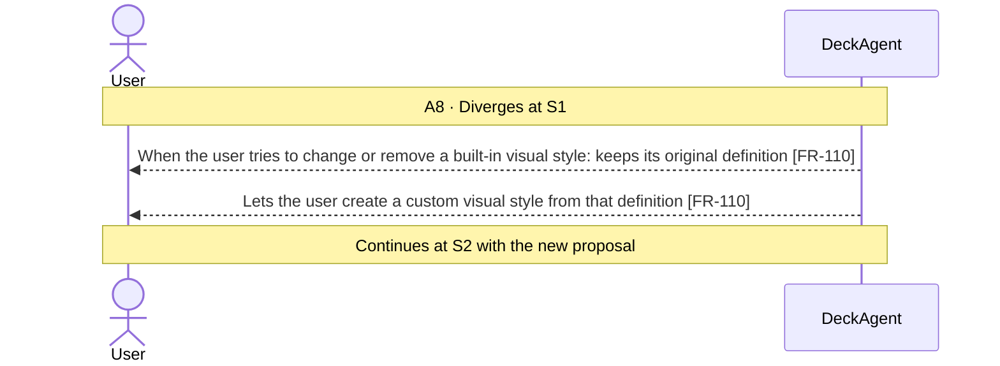
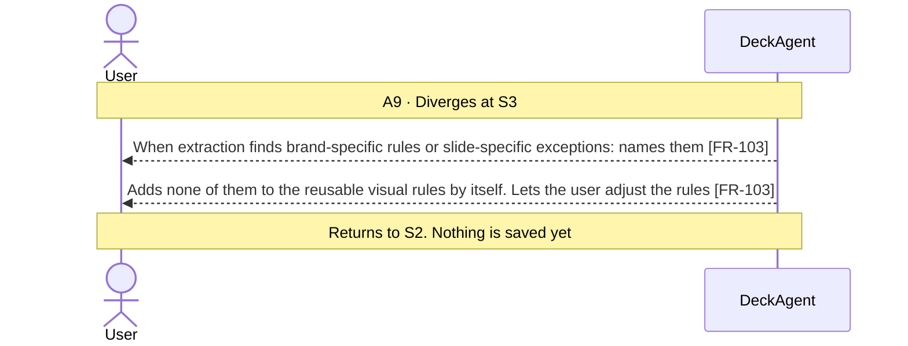

Updated at: 26-10-2026

<!-- A use case models the ideal product (UCG-01 in 03-use-cases/_CRITERIA.md). Every flow it holds is a
     behavior selected for the ideal product; this use case records no rejected options. A version file
     under docs/versions/ names the flows it takes; the use case holds no versions field (UCG-09).
     Write in plain English: docs/spec/_STYLE.md (UCG-11).
     Write intent and response, never interface (UCG-13, _STYLE rule 10). Open questions live in the
     design backlog of the ideal spec, outside docs/spec/. -->

## Goal

The user wants to reuse a presentation design without describing its layout and visual rules for each deck. They describe the design once, or point at a design they already have, and use it again later. The result is a saved **custom visual style**. It is not a deck and not a **design system**.

## Preconditions

- **Trigger:** The user chooses to set up a visual style for later decks. An example is while preparing a first draft (UC-001 A44).
- **Preconditions:** DeckAgent runs on the user's computer.

## Interactions

How to read the interactions:

- A **visual style** is a reusable set of presentation design rules. Examples are layout preferences, information density, heading treatment, visual hierarchy, image and illustration treatment, chart presentation, and motion.
- A **built-in visual style** comes from DeckAgent. Its original definition cannot be changed or removed. A **custom visual style** is created or changed by the user.
- A visual style is independent of a design system. It is not saved inside one, and a design system is not saved inside it. The same visual style can be used with several design systems (Note 1).
- The main flow makes a new custom visual style from a description. A1 to A9 cover the other ways to create, change or remove one.
- This use case builds no deck, changes no deck, and makes or changes no design system.
- How and where the system keeps a visual style is not part of this use case.

### Main Flow (MF)

### Alternative Flows

#### A1 · Start from an existing visual style

#### A2 · Extract a style from the current deck

#### A3 · Extract a style from a reference presentation

#### A4 · Edit a saved Custom Visual Style

#### A5 · Delete a Custom Visual Style

#### A6 · Leave without saving

#### A7 · Insufficient or contradictory style rules

#### A8 · Attempt to change a built-in Visual Style

#### A9 · Reference contains brand-specific rules or design exceptions

## Behavior constraints

- The result of the main flow is a saved custom visual style. It is not a deck and not a design system.
- A custom visual style is independent of every design system. Its source never becomes an ownership dependency (Note 1).
- A visual style provides reusable design guidance. It holds no fixed content and requires no identical slide layout (Note 2).
- No flow changes an existing deck, a design system, or another visual style [FR-106].
- A built-in visual style keeps its original definition [FR-110].

- **Postconditions:**
  - Main flow and A1: the new custom visual style is among those the user can choose for a deck.
  - A4: the custom visual style has the new rules under its name. Earlier decks are as they were.
  - A5: the visual style is no longer among those the user can choose. Existing decks are as they were.
  - No deck and no design system changed.
- **Minimal guarantee:** Whatever branch fails or is left:
  - Every saved visual style and design system is as it was, except one the user changed and saved or removed.
  - Every existing deck is as it was.
  - The conversation, the request text and the attachments are as they were.

## Notes

1. A visual style is independent of a design system. It is not saved inside one, and it does not own one. The same visual style can be used with several design systems [FR-104].
2. A visual style gives reusable design guidance. It is not a deck template: it holds no content and requires no identical slide layout. The system chooses the layout of each slide from its content and the visual style [FR-104].
3. Built-in visual styles come from DeckAgent. The user can choose one or copy it into a custom visual style, and cannot change its original definition [FR-110]. The product sets no default visual style: with none chosen, the system chooses a suitable design [FR-094].
4. A source deck or reference presentation is a reference, not an ownership dependency. The new visual style keeps no link to the deck or file it came from (Note 1).
5. Which design rule fields a visual style holds, and which parts of a reference presentation extraction can interpret, are questions in the design backlog of the ideal spec.
