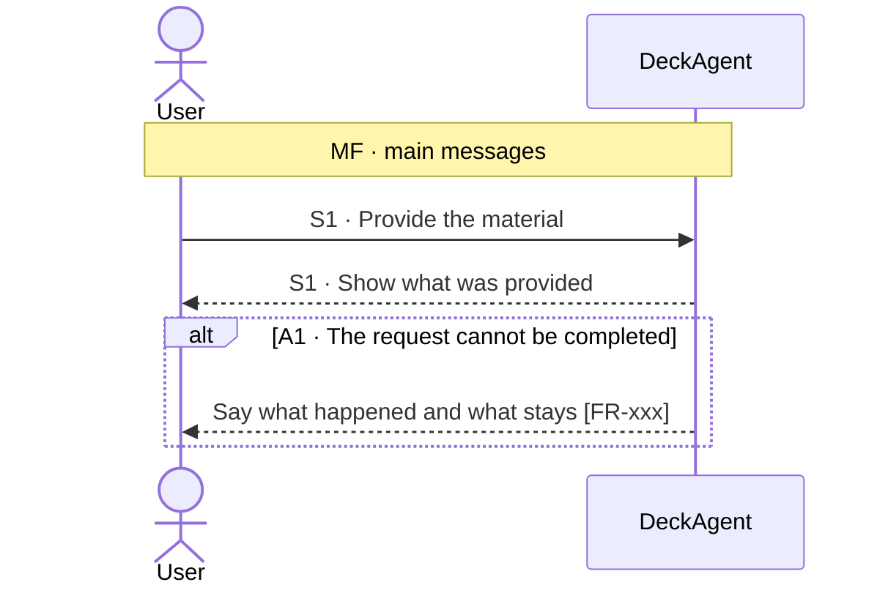

Updated at: DD-MM-YYYY

<!-- A use case models the ideal product (UCG-01 in _CRITERIA.md). Active interactions are the
     product-level exchanges DeckAgent is designed to perform. Activity is a product-design status:
     it is not a version choice, and it is not Open/Closed document state.
     A version file under docs/versions/<version>/ names the flows it takes. No `versions` field (UCG-09).
     Write in plain English: docs/spec/_STYLE.md (UCG-11).
     Write intent and response, never interface (UCG-13, _STYLE rule 11). No control, menu, gesture, position, look or label.
     Name a place only by a zone: request area, conversation, deck canvas. Before you finish, run the interface check in _STYLE.md.
     Keep the step IDs (Sx) and flow IDs (Ax) stable and visible in the diagrams (UCG-03, UCG-10):
     files under docs/spec/, docs/versions/ and docs/design/ cite them, for example "UC-003 S2". -->

## Goal
<!-- The user's intent and expected result, in one short paragraph (UCG-02). No feature or solution. -->

## Preconditions
<!-- The trigger, and only conditions that affect the interaction. Observable. No implementation and no interface. -->

## Active interactions
<!-- One or more Mermaid sequence diagrams, split by named interaction sections when the case is large (UCG-03).
     Participants are the product parties, usually `User` and `DeckAgent`. No architecture components.
     Each message keeps its flow or step ID (MF and Sx for the main flow, Ax for a branch) beside its label.
     Use alt / opt / loop for conditions; name the applicable flow ID in the alt or opt label.
     Cite [FR-xxx], [BR-xxx], [NFR-xxx] on the messages they constrain; detail lives in the requirement, not here.
     Evidence line: one compact list, one line per flow with its tags from _STYLE.md. -->

- **MF:** [observed: source (what it showed)] [assumed]
- **A1:** [assumed]

## Behavior constraints
<!-- Postconditions, minimal guarantee, and only the rules a diagram cannot express briefly.
     Cite FR/NFR/BR rather than restating acceptance conditions. Omit when empty. -->

## Closed flows
<!-- Considered alternatives that the product does not perform (UCG-04). One row per flow.
     Never invent a reason. Keep the flow ID stable. Omit the section when there are none. -->

| ID | Description | Why not selected | Reconsider when / source |
|---|---|---|---|

## Product evidence
<!-- Coverage only: observed | not offered | unverified. Raw observations stay in docs/research/use-cases/.
     One block per baseline product. -->

### Claude Slide Design

- **Coverage:** unverified
- **Research card:**
- **Difference:**

## Decisions needed
<!-- Only genuinely unresolved owner questions. Keep the old question numbers and the flow IDs they name,
     because Notes and other files cite them (UCG-10). Mark a settled question as Settled with its date.
     Omit the section when there are none. -->

## Notes
<!-- Why this is not the same case as another. Owner decisions and their dates. Design choices that become
     ADR proposals. Do not name segments. Numbers are stable: other files cite "UC-xxx Note n". Omit when empty. -->
