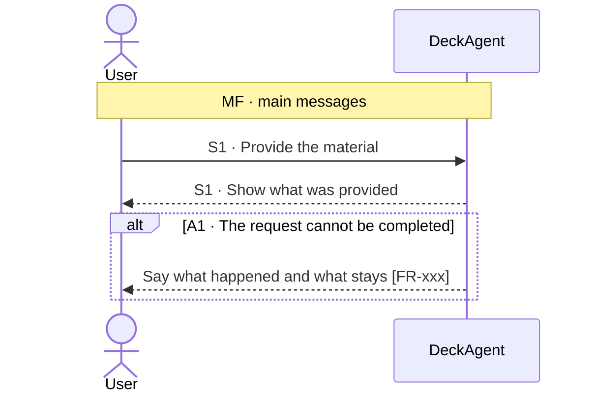

Updated at: DD-MM-YYYY

<!-- A use case models the ideal product (UCG-01 in _CRITERIA.md). Every flow it holds is a
     behavior selected for the ideal product; it records no rejected options and no decisions
     process. A version file under docs/versions/<version>/ names the flows it takes. No
     `versions` field (UCG-09).
     Write in plain English: docs/spec/_STYLE.md (UCG-11).
     Write intent and response, never interface (UCG-13, _STYLE rule 10). No control, menu, gesture, position, look or label.
     Name a place only by a zone: request area, conversation, deck canvas. Before you finish, run the interface check in _STYLE.md.
     Keep the step IDs (Sx) and flow IDs (Ax) stable and visible in the diagrams (UCG-03, UCG-10):
     files under docs/spec/, docs/versions/ and docs/design/ cite them, for example "UC-003 S2".
     A question the owner has not decided goes to the design backlog of the ideal spec, outside docs/spec/. Never write an answer for it here. -->

## Goal
<!-- The user's intent and expected result, in one short paragraph (UCG-02). No feature or solution. -->

## Preconditions
<!-- The trigger, and only conditions that affect the interaction. Observable. No implementation and no interface. -->

## Interactions
<!-- One or more Mermaid sequence diagrams, split by named interaction sections when the case is large (UCG-03).
     Participants are the product parties, usually `User` and `DeckAgent`. No architecture components.
     Each message keeps its flow or step ID (MF and Sx for the main flow, Ax for a branch) beside its label.
     Use alt / opt / loop for conditions; name the applicable flow ID in the alt or opt label.
     Cite [FR-xxx], [BR-xxx], [NFR-xxx] on the messages they constrain; detail lives in the requirement, not here.
     `FR-?` only while a decided behavior has no requirement yet; never for an open question (UCG-06). -->

## Behavior constraints
<!-- Postconditions, minimal guarantee, and only the rules a diagram cannot express briefly.
     Cite FR/NFR/BR rather than restating acceptance conditions. Omit when empty. -->

## Notes
<!-- Only a boundary or a choice that the behavior itself cannot show: why this is not the same
     case as another, what the ability promises nothing about. One subject per note; numbers are
     stable, because other files cite "UC-xxx Note n". No decision history and no dates of
     decisions; git history keeps changes. Do not name segments. Omit the section when empty. -->
