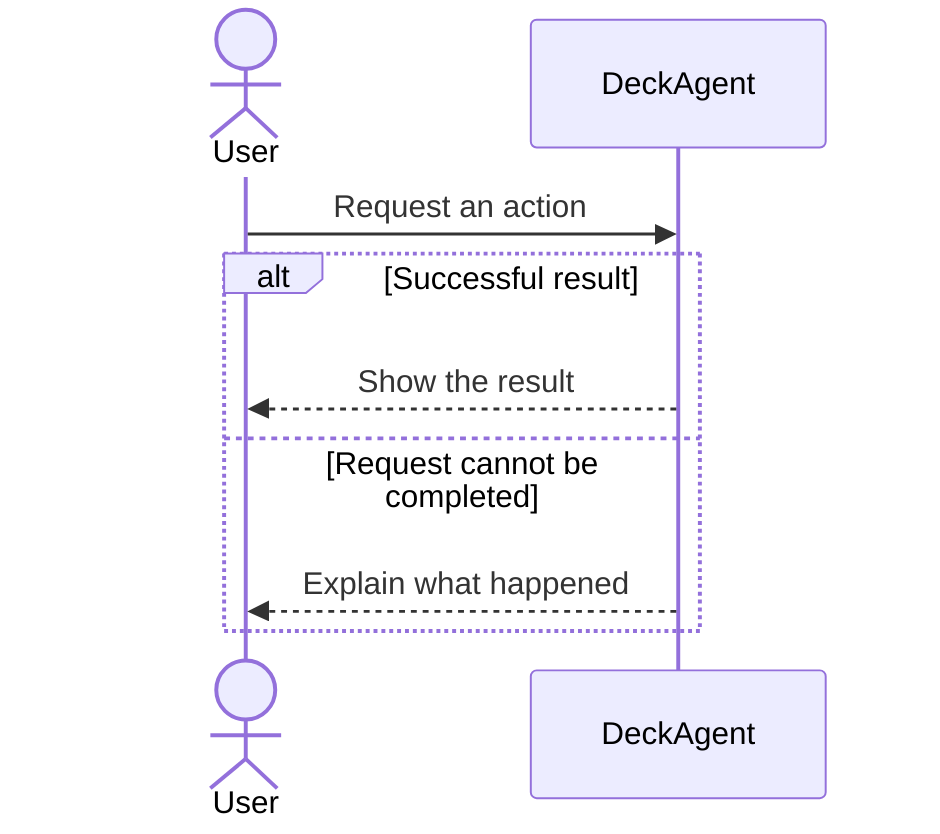

# DeckAgent — Fast Product Spec Migration Plan

**Repository:** `Luke23127006/DeckAgent`  
**Starting reference:** branch `dev`, commit `d8a6f2f73bdea288aaaf9d75b8958ff27965da47` (2026-10-25)  
**Suggested repo path:** `docs/versions/v1/product-spec-sequence-migration-plan.md`  
**Executor:** coding agent (for example GLM 5.3 Flash)  
**Type:** executable documentation migration plan, not a new product-design decision.

## Goal

Update the documentation system **in one direct migration**, not a sequence of experiments. Make `docs/spec/` easier to read and maintain:

- Model the **ideal DeckAgent product**, not V1.
- Use product-level Mermaid `sequenceDiagram` to describe **Active** user/product interactions.
- Keep **Closed** alternatives briefly: ID, description, reason, optional reconsideration condition/reference. No full diagram required.
- Make `docs/versions/v1/SCOPE.md` the only owner of V1 flow selection. It already exists; do not create another scope file.
- Update every relevant template, criterion, style rule, skill, hook, mirror, and reference **in the same change**.
- Preserve existing behavior and V1 decisions. **Do not implement product code.**

**Success:** all 12 Use Cases and all authoring instructions use the new format; the flow inventory and V1 scope remain traceable; old flowchart tooling no longer triggers; Markdown/Mermaid render; relevant checks pass. No pilot, no extra approval stage for formatting, no large research report.

## Decisions that must not be confused

| Concept | Meaning | Home |
|---|---|---|
| Product flow **Active** | Considered and selected for the ideal product | `docs/spec/03-use-cases/` |
| Product flow **Closed** | Considered but not selected for the ideal product; retained for future review | `docs/spec/03-use-cases/` |
| V1 **Accepted / Held / Not considered** | A version's implementation choices; not Product Design status | `docs/versions/v1/SCOPE.md` |
| FR/NFR/BR `confirmed / proposed / pending` | Approval or completeness of individual statements/values | Respective requirements/rules |
| Vision/User Segment `Draft / Active` | Existing document lifecycle; **not** a flow status | Existing Vision/User Segment docs |

**Critical:** `Held != Closed`, and `Accepted != automatic authorization to set Active`. A flow's presence in spec means it was considered, **not** necessarily selected. Do not turn the user's hypothetical “provider management might be Closed” into a real DeckAgent decision.

### Handling missing Product Design decisions without stopping the whole migration

- Use explicit owner decisions and existing documented intent to assign Active/Closed **only when justified**.
- Where evidence does not establish the choice, **do not guess**. Preserve the flow's ID and meaning in a short `## Decisions needed` section in its Use Case; do not label it Active or Closed. This is an **unresolved migration item**, not a third product status. Keep it visible and continue other files.
- Write one compact decision table in `docs/versions/v1/product-spec-migration-decisions.md`: `UC/flow | question | source reviewed | why unresolved | impact`. Do not create a separate document per decision.
- If an unresolved flow is already accepted in V1, flag it as **high priority for owner review**, but **do not change** the V1 scope to make the conflict disappear.
- Never invent reasons for Closed flows. If the source supports Closed but not the reason, mark `Reason: owner rationale not recorded` and add one decision-table row.

## Target Use Case format

Use this small structure; optional sections must be omitted when empty. Keep existing YAML `id`, `title`, `level`, `includes`, `extended_by`, `next` if applicable. Do **not** add a `versions` field.

````md
---
id: UC-000
title: "User goal"
level: user-goal
includes: []
extended_by: []
next: []
---

## Goal
User intent and expected result in 1–3 sentences.

## Preconditions
Only conditions that affect the interaction.

## Active interactions



## Behavior constraints
Only important rules that a diagram cannot express briefly; cite FR/NFR/BR rather than restating detailed acceptance conditions.

## Closed flows
| ID | Description | Why not selected | Reconsider when / source |
|---|---|---|---|
| A2 | A considered alternative | Existing recorded reason | Optional |

## Decisions needed
Only unresolved product choices; preserve stable IDs and source references.
````

### Diagram and identity rules

- Participants express **product interactions**, usually `User` and `DeckAgent`. Do not turn the diagram into an architecture with LLM/Agent Runtime/Tools/DB components.
- Use `alt`, `opt`, `loop` where helpful. Split a crowded diagram into named **interaction sections within the same UC** rather than forcing everything into one image.
- Keep the existing **UC IDs** and **MF/Ax flow IDs**. Make `MF` and individual Active `Ax` IDs visible beside the applicable diagram labels/`opt`/`alt` branches, or in a very short flow index when a label would hurt readability. A sequence diagram can contain multiple scenarios; one `Ax` remains independently identifiable.
- Legacy `Sx` step IDs can be removed from the main presentation only after all references to each step have been updated or mapped. Do not silently break citations such as `UC-006 S3`.
- Keep distinct failure paths, conditions, preserved state, user-visible guarantees, dependencies (`includes` etc.), and FR/BR/NFR references. Move detail into the correct existing requirement when appropriate; **do not discard it merely to make the UC shorter**.
- Do not reproduce the same behavior as full prose under the diagram. A short constraint is acceptable when the diagram cannot express an important invariant clearly.
- Existing research evidence and owner decisions must stay accessible. Prefer concise citations/links; move long research narratives to existing `docs/research/` sources rather than rewriting them in the Use Case.
- Closed flows **do not require** a diagram. Existing detailed evidence for them must not be destroyed when it contains unique decisions.
- `Open questions` may be retained under `Decisions needed`; distinguish resolved decisions from genuinely unresolved questions.

## Do the work: 4 stages, one working branch

### Stage 1 — Quick inventory and migration contract

**Do first, then immediately edit. Do not create a standalone audit report or a pilot.**

1. Read `AGENTS.md`, `docs/AGENTS.md`, relevant templates/criteria, `docs/versions/v1/SCOPE.md`, and `docs/agents/skill-maintenance.md`.
2. Inspect `git status --short` and current branch/commit. Preserve unrelated/uncommitted changes. Do not reset, force-clean, or overwrite another contributor's work.
3. Count Use Cases and their `MF/Ax` IDs. Capture V1 Accepted/Held references. At the reference snapshot there are **12 UC files**, **121 flows**, and V1 scope says **61 Accepted**, **21 Held**, **39 flows in 6 UCs not considered**; verify counts at execution time rather than trusting a stale snapshot.
4. Search references to `UC-xxx Sx`, `UC-xxx Ax`, `MF`, `versions`, `Flow at a glance`, `BEGIN generated: use-case-flowchart`, `use-case-flowchart`, `Updated at`, and rules equating confirmation with V1 flow selection. Exclude generated dependencies/vendor content. Use results to update consumers, not to rewrite historical research documents indiscriminately.
5. Identify any flow whose Active/Closed choice is explicitly recorded. For all other cases use the short `Decisions needed` rule above. Do not wait for every owner answer before continuing the formatting migration.

**Done when:** agent has an inventory of files/IDs and knows which references require edits. Keep working notes short; no report document required.

### Stage 2 — Update the writing contract and agent tooling

Edit the canonical sources, keeping rules **short** and avoiding duplicate instructions:

| File | Required update |
|---|---|
| `docs/spec/03-use-cases/_TEMPLATE.md` | Replace Sx/Ax prose blocks and generated flowchart with new compact format; show Active diagram, Closed table, optional decisions. |
| `docs/spec/03-use-cases/_CRITERIA.md` | Define Active/Closed as ideal-product choices; clear ID/reference rules; diagram rules and no-release boundary; remove old block/flowchart criteria and overly rigid formatting rules. |
| `docs/spec/_STYLE.md` | Keep plain English, consistent terms and product-level language; remove no-longer-useful mandatory per-block formatting checks. |
| `docs/AGENTS.md` | Permit **flow-level** Active/Closed while forbidding release selection in spec; remove mandatory `### Updated at` and legacy generated-flowchart instructions; point to the canonical new criteria. |
| `.agents/skills/spec-authoring/SKILL.md` | Replace old Sx/Ax and obsolete `versions`/`use-case-flowchart` guidance; require new template, behavior preservation and decision reporting. |
| `.agents/skills/use-case-flowchart/SKILL.md` | Retire this skill; new Sequence Diagrams are authoritative, not generated from prose. |
| `.agents/skill-manifest.json` | Remove/retire old skill entry; record spec-authoring local change. |
| `docs/agents/skill-router.md` | Remove flowchart trigger; route UC diagram editing through `spec-authoring` and `mermaid-markdown`. |
| `.claude/hooks/use-case-flowchart-reminder.sh`, `.claude/settings.json` | Remove obsolete hook and its registration. |
| `.agents/skills/mermaid-markdown/SKILL.md` | Keep general portability guidance; add only missing advice necessary for UC sequence diagrams. Do not duplicate the UC contract. |
| `.claude/skills/`, `.codex/skills/` | **Never edit manually.** Regenerate mirrors from `.agents/skills/`. |

**Other spec standards:** Inspect Vision/User Segment/FR/NFR/BR `_TEMPLATE.md` and `_CRITERIA.md`. Change only instructions that contradict the new model. In particular, FR/NFR/BR sources must **not** treat “selected by a version” as automatic proof of an ideal-product decision. Preserve their existing `confirmed/proposed/pending` semantics, IDs and acceptance conditions; do not rewrite all FR/NFR/BR just for a new layout.

**Commands:**

```sh
python .agents/scripts/sync_skill_mirrors.py --prune
python .agents/scripts/sync_skill_mirrors.py --check
```

If `--prune` finds modified mirrors, inspect first. **Never use `--force` merely to finish faster.** Follow `docs/agents/skill-maintenance.md` for mirror-only changes.

**Done when:** new writing instructions agree, old flowchart skill/hook no longer trigger, and mirrors match canonical skills. Continue directly to Stage 3; do not wait for separate pilot approval.

### Stage 3 — Convert all Use Cases directly

Convert **UC-001 through UC-012** in one migration pass. No trial UC, separate review gate, or phased rollout.

For each UC:

1. Read it once, including source notes and linked requirements needed to understand its interactions.
2. Replace the Main Flow, Alternative Flows and generated flowchart with compact Active sequence diagram(s), Closed summary table, and optional `Decisions needed` section.
3. Preserve every `MF/Ax` identity. Mark every legacy flow as **Active**, **Closed**, or **unresolved in Decisions needed** based on evidence; no silent omissions.
4. Preserve conditions and outcomes through the diagram, short constraints or correct FR/BR/NFR references. Keep user-visible behavior consistent with original decisions.
5. Update other files referencing deleted `Sx` step blocks. Keep links that resolve; fix those that no longer do.
6. Remove stale generated block markers, redundant per-block `Updated at` entries and boilerplate that no longer serves the new format.

**Prioritize simple edits, not perfect visual polish.** A large Use Case may use several diagram blocks. Keep behavior accuracy over diagram compactness.

After UCs are converted, make **one focused consumer pass**:

- `docs/versions/v1/SCOPE.md`: update **references only** if required; leave V1 Accepted/Held/Not considered decisions and product choices unchanged. Check whether accepted flows conflict with unresolved/Closed status and report them, **do not silently fix scope**.
- `docs/versions/README.md`: preserve the distinction between ideal product and version choice; remove claims that spec cannot contain Active/Closed *flow design* status.
- Vision/User Segment/FR/NFR/BR files: update broken UC references, statements that say a version selection confirms ideal-product behavior, and direct contradictions. **Do not bulk reformat content or delete requirements.**
- `AGENTS.md`, `CLAUDE.md`, `docs/agents/`, `docs/development/`, `docs/tooling/`, `.github/` and active plans: update operational references that would actively instruct agents to use obsolete structures. **Historical research/plans remain historical** unless a link is broken or they actively control current tooling.

Known source conflicts to review, without inventing a decision: `UC-006 A1/A6` versus `FR-048/FR-052` and V1 chat behavior; `UC-001 A14` versus `UC-003 A14` and `FR-014`. Provider-management status is **not decided by the user's example**.

**Done when:** all 12 UCs use the new layout, every legacy flow ID is accounted for, and operational references are consistent.

### Stage 4 — Run the few checks that catch real damage

Do **not** build a new large validation framework for this migration. Small scripts or one-off checks are enough, provided the results are recorded.

**Required checks:**

1. **Flow accounting:** compare the original `UC + MF/Ax` inventory with the converted spec. Every ID must exist exactly once as Active, Closed or unresolved. No missing IDs, accidental renames, or duplicate statuses.
2. **V1 protection:** compare before/after `SCOPE.md` accepted, held and not-considered sets; ensure unchanged decisions. All IDs still resolve. Flag any V1 Accepted flow not confirmed Active as an outstanding product decision rather than silently relabeling it.
3. **References:** search for broken UC/step/flow/FR/NFR/BR links and obsolete instructions. Do not forbid valid historical mentions of `versions` in a migration note; forbid obsolete *live directives* and `versions:` fields in spec documents.
4. **Mermaid:** syntax-check **all** migrated `sequenceDiagram` blocks using an available renderer (`mmdc`, Mermaid CLI, or repository-compatible preview). Inspect representative long/branch-heavy diagrams in GitHub or VS Code Markdown preview. Say explicitly if a visual renderer was unavailable.
5. **Agent instructions:** `python .agents/scripts/sync_skill_mirrors.py --check`; confirm old hook/skill is no longer registered and no canonical skill instructs agents to generate `Flow at a glance`.
6. **Repository hygiene:** `git diff --check`, inspect `git diff --stat` and `git status --short`; run only relevant existing checks, not the entire product test suite unless tooling changes affect product code. Do not install new tooling merely to satisfy a cosmetic check.

**Done when:** required checks pass or the remaining issues are named clearly. Never call a failed or unrun check PASS.

## Files in scope (quick reference)

**Must examine/change:**

- `docs/spec/03-use-cases/UC-001.md` … `UC-012.md`
- `docs/spec/03-use-cases/_TEMPLATE.md`, `_CRITERIA.md`, `docs/spec/_STYLE.md`
- `docs/AGENTS.md`
- `.agents/skills/spec-authoring/SKILL.md`, `.agents/skills/use-case-flowchart/SKILL.md`
- `.agents/skill-manifest.json`, `docs/agents/skill-router.md`
- `.claude/hooks/use-case-flowchart-reminder.sh`, `.claude/settings.json`
- Generated `.claude/skills/` and `.codex/skills/` mirrors
- `docs/versions/v1/SCOPE.md` **only if necessary to repair references; no scope choices**

**Inspect and edit only when needed:**

- `docs/spec/01-product-vision/`, `02-users/`, `04-requirements/fr/`, `04-requirements/nfr/`, `05-business-rules/` including `_TEMPLATE.md` and `_CRITERIA.md`
- `AGENTS.md`, `CLAUDE.md`, `docs/versions/README.md`, `docs/agents/skill-maintenance.md`, `docs/agents/`, `.agents/skills/mermaid-markdown/`, `.github/workflows/`, current docs linking to UC steps

**Out of scope:** application code, runtime architecture, UX prototypes, changing FR/NFR/BR meaning, changing V1 Accepted/Held membership, assigning unrecorded owner decisions, rewriting historical research solely for style.

## Final delivery (one short report, not six reports)

At the end, give:

1. **Changed:** main files and systems updated (UC, template/criteria/style, skills/hooks/mirrors, references).
2. **Counts:** number of UCs converted; Active/Closed/unresolved flow counts; original flow IDs preserved; V1 scope parity.
3. **Checks:** actual commands, PASS/FAIL/NOT RUN, and the key output.
4. **Owner decisions needed:** a compact table with only unresolved high-impact product choices and V1 conflicts; link to `product-spec-migration-decisions.md`.
5. **Limits:** anything not checked, blocked, or requiring manual review.

No separate pilot, formal stage approval, multiple phase reports or large checklist artifacts are required. Make all authorized mechanical edits in one pass and stop only when a real product decision or risk of data loss makes that specific edit unsafe. Do not publish, commit, push, or open PRs unless the user separately authorizes those actions.
